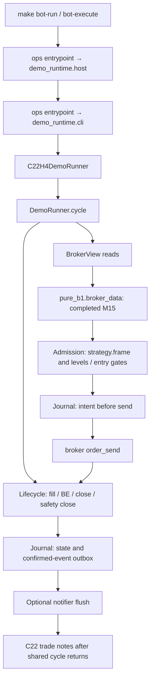

# Codebase layout and module interfaces

C22H4 is the active Demo interface. `scripts/demo_runtime` owns shared execution;
C22 and trial30 supply their existing strategy interfaces. Trading contract remains
[CORE_STRATEGY.md](../../CORE_STRATEGY.md). Domain terms: [CONTEXT.md](../../CONTEXT.md).

```text
scripts/
  c22h4/                 Frozen detector adapter, notes and causal cache export
  demo_runtime/
    runner.py            DemoRunner orchestration, UTC clock and cycle envelope
    admission.py         Detection, entry gates, intent commit and dispatch
    lifecycle.py         Fill reconciliation, BE, complete close and safety close
    broker.py            Identity, exposure, history, quote, spec and day baseline
    journal.py           SQLite state/outbox and local single-writer guard
    costs.py             Cost-attestation validation
    cli.py               Shared CLI, config gates, watch loop and shutdown
    host.py              Wine launcher and credential redaction
    status.py            Read-only local journal/process presentation
  trial30/               Rollback strategy adapter and compatibility imports
  ops/                   Existing command entrypoints and read-only probes
  research/              Frozen campaigns; original paths/bytes retained
  smc/, pure_b1/         Existing imported helpers and legacy/research stacks
  webhook/               Legacy webhook stack
  debug/reviews/         Historical offline review reproducers
mql5/                    Native sources and no-order harnesses, unchanged
config/, specs/          Strategy/config contracts and source pins, unchanged
tests/demo/              Public cycle, compatibility, CLI/status and strategy tests
tests/<other-family>/    Existing application/native/B1/research/SMC/webhook suites
docs/ops/                Operator runbooks
docs/reviews/            Synthesized human-readable markdown only
docs/archive/            Historical documents
runs/                    Ignored generated evidence, logs and checkpoints
```

## Execution path



`DemoRunner` requires a strategy constructor argument. The strategy retains
`frame`, `levels`, `protects`, `diagnostics`, optional `entry_thesis` and its existing
contract attributes. `C22H4DemoRunner` inherits `DemoRunner` directly;
`Trial30DemoRunner` supplies the rollback default and retains its keyword-only
constructor, `cycle(now=...)`, `close()` and caller-visible attributes.

Admission and lifecycle use composition with the runner as shared internal
context. They add no persisted state or state machine. Existing private runner
methods forward to collaborators, preserving overrides/callers. The broker-call,
journal-write, exception and outbox ordering remains unchanged. Notes still run
after the shared cycle; known note failures and other failure-matrix GAPs remain
separate remediation work.

Old broker/journal/costs and shared ops imports resolve to the same implementation
module object, preserving legacy patch targets (`clock_now`, `ROOT`, `time`).
Existing script and `python -m` entrypoints retain flags/defaults/exit codes.
No pinned B1/SMC implementation is copied or relocated. CLI defaults still select
the trial30 rollback unless the C22 entrypoint supplies its strategy/config.

## Debug entrypoints

Commands below are offline tests; none initializes a real broker.

| ขั้นตอน | Module | Tests | คำสั่งตรวจ |
| --- | --- | --- | --- |
| Market data / detection / cache | `pure_b1/broker_data.py`, `c22h4/strategy.py`, `c22h4/runner.py` | `test_c22h4_strategy`, `test_c22h4_demo`, `test_c22h4_history_probe` | `.venv/bin/python -m unittest tests.demo.test_c22h4_strategy tests.demo.test_c22h4_demo tests.demo.test_c22h4_history_probe` |
| Admission / costs | `demo_runtime/admission.py`, `costs.py` | `test_trial30_demo`, `test_c22h4_demo` | `.venv/bin/python -m unittest tests.demo.test_trial30_demo tests.demo.test_c22h4_demo` |
| Broker / fill / BE / close / safety | `demo_runtime/broker.py`, `lifecycle.py` | `test_trial30_demo`, `test_c22h4_safety_recovery` | `.venv/bin/python -m unittest tests.demo.test_trial30_demo tests.demo.test_c22h4_safety_recovery` |
| Journal / outbox / writer guard | `demo_runtime/journal.py`, `runner.py` | `test_trial30_demo`, `test_c22h4_demo`, `test_demo_runtime_compatibility` | `.venv/bin/python -m unittest tests.demo.test_trial30_demo tests.demo.test_c22h4_demo tests.demo.test_demo_runtime_compatibility` |
| Notes | `c22h4/runner.py`, `trade_log.py` | `test_c22h4_trade_log` | `.venv/bin/python -m unittest tests.demo.test_c22h4_trade_log` |
| CLI / host / status / imports | `demo_runtime/cli.py`, `host.py`, `status.py`; `ops` facades | `test_c22h4_cli`, `test_trial30_cli`, `test_trial30_status_brief`, `test_demo_runtime_compatibility` | `.venv/bin/python -m unittest tests.demo.test_c22h4_cli tests.demo.test_trial30_cli tests.demo.test_trial30_status_brief tests.demo.test_demo_runtime_compatibility` |
| Entire Demo interface | All above | `tests/demo` | `make test-demo` |
| Full regression | All stacks | `tests` | `make test` |

## Retained contracts and evidence

One account, one sender. Trial30 rollback cannot run concurrently with C22.
`main.py`, `smc_main.py`, webhook and native research EA keep their separate roles.
Configs, specs, native sources, frozen research paths and historical evidence are
retained. Old source links in archived reports describe their recorded snapshot.
The archived SMC glossary does not add rules to either Demo strategy.

Generated refactor evidence lives under `runs/demo-runtime-refactor-2026-10-17/`
(the campaign began before local midnight). Validation is offline and does not
change the system's readiness or authorize watcher restart, broker connection,
cutover or deployment.
