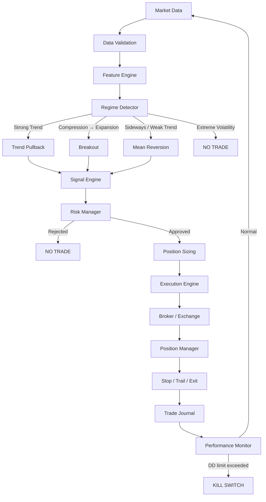
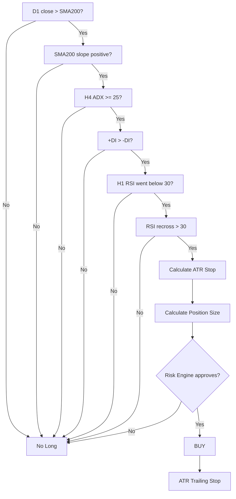
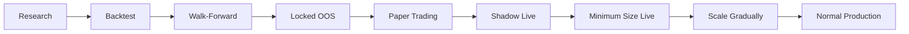

# ออกแบบ Gold Trading Bot ให้เป็น “ระบบ” ที่มีโอกาสทำกำไรจริง

## แนวคิดหลัก: อย่าเอาทุก Strategy มารวมเป็น Indicator Soup

ถ้าจะเปลี่ยนเทคนิคทั้งหมดจากรายงานก่อนหน้าให้กลายเป็น bot ที่เอาไปเทรดเงินจริง จุดสำคัญที่สุดคือ **ไม่ควรเอา RSI + Bollinger + ADX + Donchian + Momentum + Seasonality + Grid มารวมกันแล้วให้ทุกตัว vote Buy/Sell พร้อมกัน** เพราะสุดท้ายมักกลายเป็นระบบที่ overfit และมีเงื่อนไขจำนวนมากจนผล backtest ดูดีแต่ live พังได้ง่าย งานด้าน backtest overfitting ชี้ว่าการเลือก strategy/parameter จากการทดลองจำนวนมากสามารถทำให้ historical performance สูงเกินจริงอย่างมีนัยสำคัญ และแม้แต่ Sharpe ratio จาก backtest ก็ต้องระวัง selection bias. citeturn3search0turn3search1

วิธีที่ผมแนะนำคือสร้าง **Regime-Based Multi-Strategy System**:

> **ตรวจสภาพตลาดก่อน → เลือก strategy ที่เหมาะกับสภาพนั้น → ให้ Risk Engine ตัดสินขนาด position → Execution Engine ส่งคำสั่ง → Risk Manager มีสิทธิ์ veto ทุก trade**

ไม่ใช่:

> indicator หลายตัว → vote → all-in

โครงสร้างควรเป็นแบบนี้:



**เป้าหมายไม่ใช่สร้าง bot ที่ “ทายทองถูก” แต่สร้าง bot ที่มี positive expectancy หลัง transaction costs และสามารถอยู่รอดในหลาย market regime**

\[
Expectancy =
P(win)\times AvgWin -
P(loss)\times AvgLoss -
TradingCosts
\]

ไม่มี strategy ใดรับประกันกำไรจริงได้ สิ่งที่เราสามารถ engineer ได้คือให้ระบบมี **ความได้เปรียบเชิงสถิติ + จำกัด downside + ทดสอบโดยไม่หลอกตัวเอง**.

สำหรับเวอร์ชันแรก ผมแนะนำให้ใช้เพียง:

**D1 = Market Bias → H4 = Regime → H1 = Entry**

และเปิดใช้เพียงสาม engine:

1. Trend Pullback
2. Volatility Breakout
3. Mean Reversion

ส่วน Time-Series Momentum ใช้เป็น macro filter, Seasonality เก็บไว้เป็น feature สำหรับ research และ **ปิด Martingale/Grid ใน production v1**.

OANDA เองยกตัวอย่าง gold ที่ใช้ higher timeframe เช่น H4/Daily/Weekly เพื่อกำหนด trend แล้วลงมาหา RSI entry บน H1 ขณะที่ ADX มาตรฐาน 14 periods มักใช้ระดับประมาณ >25 สำหรับ strong trend และ <20 สำหรับ weak/non-trending regime. citeturn0search0turn2search0

## Gold System เวอร์ชันแรกที่ผมแนะนำ

ผมจะเรียกระบบตัวอย่างนี้ว่า:

> **Gold Adaptive Regime System — GARS v1**

ค่าด้านล่างแบ่งเป็นสองประเภทชัดเจน:

**Evidence-based baseline** = มีแหล่งอ้างอิงรองรับว่าเป็น parameter/approach ที่ใช้งานกัน  
**Research parameter** = ค่าที่ผมเสนอให้เริ่ม backtest ไม่ได้หมายความว่าเป็นค่าที่ทำกำไรดีที่สุด

### Feature set

| Feature | Parameter เริ่มต้น | หน้าที่ | สถานะ |
|---|---:|---|---|
| SMA | 200 | Long-term bias | Evidence-based |
| ADX | 14 | Trend strength | Evidence-based |
| +DI / -DI | 14 | Trend direction | Evidence-based |
| RSI | 14 | Pullback / reversal timing | Evidence-based |
| Bollinger Bands | 20, 2σ | Compression / mean reversion | Evidence-based |
| ATR | 14 | Volatility / SL / sizing | Evidence-based |
| Donchian | 20 | Breakout confirmation | Research baseline |
| BB Width percentile | 20th percentile / 120 bars | Detect squeeze | Research baseline |
| TSMOM | trailing 12 months | Macro direction filter | Research-backed |
| Seasonality | disabled initially | Optional feature | Research only |

OANDA ใช้ 200-period moving average เป็น higher-timeframe trend filter ในตัวอย่าง XAUUSD และ RSI recross 30 เพื่อหา long pullback entry; Bollinger squeeze ใช้จับช่วง consolidation ก่อน volatility expansion ส่วน ATR สามารถใช้กำหนด stop เป็น multiple เช่น 1.0×, 1.5× และ 2.0× ATR รวมถึงนำไปใช้ position sizing ได้. citeturn0search0turn0search1turn0search2

สำหรับ ADX ค่า standard period ที่พบทั่วไปคือ 14 และ OANDA อธิบายว่า ADX >25 มักบ่งชี้ strong trend ขณะที่ <20 บ่งชี้ weak/choppy regime. citeturn2search0

ส่วน trailing 12-month momentum มาจากงาน Time-Series Momentum ของ Moskowitz, Ooi และ Pedersen ซึ่งพบ return persistence ในหลาย futures/forwards ที่ช่วงหนึ่งถึงสิบสองเดือน และ original 12-month TSMOM ใช้ trailing 12-month signal กับ 1-month holding period; AQR ยังคงเผยแพร่ dataset ของ methodology ดังกล่าว. citeturn1search1turn1search31

### Timeframe hierarchy

```text
Monthly / D1
      │
      ├── Long-term Direction / TSMOM
      │
      ▼
     D1
      │
      ├── SMA200 Market Bias
      │
      ▼
     H4
      │
      ├── ADX / DMI
      ├── Bollinger Width
      ├── ATR
      │
      └── REGIME
           │
     ┌─────┼──────┐
     ▼     ▼      ▼
   Trend Breakout Range
     │     │      │
     └─────┼──────┘
           ▼
          H1
           │
       Entry Timing
           │
           ▼
        Risk Engine
```

### Regime Detector

นี่คือหัวใจของระบบทั้งหมด

```pseudo
if risk_event == true:
    regime = HALT

else if H4.ADX(14) >= 25:
    if H4.+DI > H4.-DI:
        regime = TREND_UP
    else:
        regime = TREND_DOWN

else if bollinger_squeeze_detected:
    regime = COMPRESSION

else if H4.ADX(14) < 20:
    regime = RANGE

else:
    regime = NEUTRAL
```

ช่วง ADX `20–25` ผมเสนอว่า **ไม่ต้อง trade** ใน v1 เพราะเป็น transition zone ที่ระบบไม่จำเป็นต้องเดาว่าจะกลายเป็น trend หรือ range ต่อไป การไม่ trade ถือเป็น valid position.

นี่เป็นข้อได้เปรียบที่ bot มีเหนือคน:

> bot ไม่เบื่อที่จะรอ

### Long-term directional filter

เพิ่ม D1 filter ก่อนเปิด Trend/Breakout:

```pseudo
bull_bias =
    D1.close > SMA200
    AND SMA200[t] > SMA200[t - 20]

bear_bias =
    D1.close < SMA200
    AND SMA200[t] < SMA200[t - 20]
```

`20-bar SMA slope` เป็น **research parameter ที่เสนอ** ไม่ใช่ parameter มาตรฐานจาก OANDA.

จากนั้นอาจเพิ่ม Time-Series Momentum:

```pseudo
momentum_12m =
    current_daily_close / daily_close_252_bars_ago - 1

macro_long  = momentum_12m > 0
macro_short = momentum_12m < 0
```

252 trading days เป็น implementation approximation ของ 12 เดือน ดังนั้นถ้าจะ reproduce งานวิจัยแบบ strict ควรคำนวณด้วย calendar/monthly return ตาม methodology ต้นฉบับแทน. แนวคิด 12-month directional momentum มีหลักฐานจากงาน TSMOM แต่ไม่ได้หมายความว่าตัวมันเองรับประกัน edge ใน gold ปัจจุบัน. citeturn1search1turn1search36

ผมจะ **ไม่บังคับ TSMOM ใน v1 production จนกว่า backtest gold-specific จะยืนยัน** แต่เก็บ feature ไว้เพื่อเปรียบเทียบ:

```text
Model A = no TSMOM
Model B = TSMOM filter
```

แล้วให้ OOS เป็นคนตอบ.

## Strategy Engines และกฎเข้าออกจริง

### Trend Pullback Engine

นี่ควรเป็น core strategy ตัวแรก เพราะ architecture ตรงไปตรงมาและสอดคล้องกับตัวอย่าง XAUUSD ของ OANDA ที่หา higher-timeframe trend ก่อนแล้วรอ RSI pullback บน H1. citeturn0search0

#### Long

ต้องผ่านทุกข้อ:

```text
D1:
close > SMA200
SMA200 slope > 0

H4:
ADX(14) >= 25
+DI > -DI

H1:
RSI(14) previously < 30
AND RSI(14) crosses back above 30
```

Entry:

```text
Buy at next tradable H1 bar
```

สำคัญมากสำหรับ backtest:

**signal จาก close ของ bar `t` ห้ามสมมติว่า fill ได้ที่ close bar `t` เว้นแต่ระบบจริงสามารถตัดสินใจและส่ง order ก่อน close ได้จริง**

baseline ปลอดภัยกว่าคือ:

```text
Calculate using completed bar t
Execute using bar t+1
```

เพื่อลด look-ahead bias ซึ่งเป็นหนึ่งในปัญหาหลักของ strategy research และ backtest optimization. citeturn3search0turn3search6

Initial SL:

```text
SL = entry - 1.5 * ATR(14)
```

Short:

```text
SL = entry + 1.5 * ATR(14)
```

`1.5× ATR` เป็นหนึ่งใน ATR multiples ที่ OANDA ยกเป็นตัวอย่างสำหรับ volatility-adjusted trailing stops; ค่าที่ดีที่สุดสำหรับระบบนี้ยังต้องหาใน OOS. citeturn0search2

ผมไม่แนะนำ fixed TP 1:2 สำหรับ trend engine ตั้งแต่แรก เพราะ trend-following มีเหตุผลที่จะปล่อย positive-tail winner วิ่ง.

ใช้:

```pseudo
if long:
    trailing_stop =
        highest_close_since_entry
        - 2.0 * ATR(14)

if short:
    trailing_stop =
        lowest_close_since_entry
        + 2.0 * ATR(14)
```

แล้ว:

```pseudo
exit_long if:
    price <= trailing_stop
    OR H4 regime == TREND_DOWN
```

อย่ารีบ move stop → breakeven ทันทีที่ +0.5R เพราะมันสามารถตัด winner จาก noise ได้; ให้ parameter นี้เป็นเรื่องของ backtest.

Flow:



### Volatility Breakout Engine

ใช้เมื่อ H4 อยู่ในช่วง compression ก่อน breakout.

Bollinger squeeze มีหลักการว่าช่วง volatility ต่ำทำให้ bands แคบ และการเปิดออกของ upper/lower bands แสดง volatility expansion; OANDA ยกตัวอย่าง XAUUSD Daily ที่เกิด squeeze ยาวก่อน breakout ในปี 2024. citeturn0search1

ปัญหาคือคำว่า “squeeze” ต้องแปลงให้เป็น algorithm.

นิยาม:

\[
BBWidth =
\frac{UpperBand-LowerBand}{MiddleBand}
\]

Research baseline ที่ผมเสนอ:

```pseudo
width_percentile =
    percentile_rank(
        current_bb_width,
        last_120_H4_bb_widths
    )

squeeze = width_percentile <= 20%
```

**120 bars และ 20th percentile เป็นค่าที่ต้อง optimize แบบ restrained / walk-forward ไม่ใช่ค่ามาตรฐานที่แหล่งอ้างอิงรับรอง**

อย่า search:

```text
lookback = 50..500 ทุกค่า
percentile = 1..50 ทุกค่า
ATR = 0.1..5 ทุกค่า
```

แล้วเลือก combination ที่สวยที่สุด เพราะนั่นคือ recipe สำหรับ backtest overfitting. งาน PBO และ Deflated Sharpe Ratio ถูกพัฒนาขึ้นมาเพื่อจัดการปัญหา selection bias จากการค้น parameter/strategy จำนวนมากโดยตรง. citeturn3search0turn3search1

Long breakout:

```text
Previous condition:
BB Width <= 20th percentile

Current H4:
BB Width rising
close > DonchianHigh(20)

D1:
close > SMA200
```

จากนั้น:

```pseudo
enter next H4 bar

SL =
    entry - 1.5 * ATR_H4(14)

trail =
    highest_close - 2 * ATR_H4(14)
```

Short = กลับด้าน.

Donchian 20 เป็น research baseline ใน GARS v1 ไม่ได้หมายความว่า 20 optimal.

จุดสำคัญคือ **Trend Pullback กับ Breakout ไม่ควรยิง position ซ้ำกัน**

ตัวอย่าง:

```pseudo
if existing_directional_position:
    reject_new_directional_signal
```

หรือรวมเป็น portfolio-level signal:

```text
Trend Long  = +1
Breakout Long = +1

ไม่ได้แปลว่า +2 positions
```

ใน v1:

```text
หนึ่ง directional thesis = หนึ่ง risk budget
```

ไม่ว่ากี่ strategy จะเห็นตรงกัน.

### Mean Reversion Engine

ใช้เฉพาะเมื่อ H4 บอกว่าไม่มี strong trend:

```text
H4 ADX(14) < 20
```

ADX ต่ำกว่า 20 เป็นบริเวณที่ OANDA ระบุว่าสามารถสะท้อน weak/directionless/choppy market ได้ ซึ่งเหมาะกว่ากับ mean-reversion logic เมื่อเทียบกับ trend-following. citeturn2search0

Long setup H1:

```text
BB = Bollinger(20, 2)
RSI = RSI(14)

Bar t-1:
close < lower Bollinger
RSI < 30

Bar t:
close returns inside lower Bollinger
RSI crosses > 30
```

Entry:

```text
Buy next bar
```

Target:

```text
TP = Bollinger middle band
```

Initial stop:

```text
SL = entry - 1.5 * ATR(14)
```

หรือถ้าต้องการ structure stop:

```text
SL = recent swing low - ATR_buffer
```

แต่เลือกอย่างใดอย่างหนึ่งก่อน อย่าสร้าง 17 ทางเลือกแล้ว optimize ทุกอย่างพร้อมกัน.

Short:

```text
ADX < 20

Previous:
close > upper BB
RSI > 70

Confirmation:
close returns inside band
RSI crosses below 70

TP:
middle band
```

Mean reversion **ห้ามทำสิ่งนี้**:

```pseudo
if losing:
    double_position()
```

และห้าม:

```text
RSI < 30 => buy
RSI < 25 => buy more
RSI < 20 => buy more
RSI < 15 => YOLO
```

เพราะ RSI oversold ไม่ได้เป็น guarantee ว่าราคาต้อง reverse; ใน strong trend oscillator สามารถอยู่ใน extreme zone ต่อเนื่องได้ ซึ่งเป็นเหตุผลว่าทำไม higher-timeframe trend/regime filter จึงสำคัญ. citeturn0search0

### Strategy Router

สุดท้าย strategy selection ควร deterministic:

```pseudo
function select_strategy(state):

    if state.system_halt:
        return NONE

    if state.extreme_volatility:
        return NONE

    if H4.ADX >= 25:
        return TREND_PULLBACK

    if H4.was_squeezed and H4.bb_width_expanding:
        return BREAKOUT

    if H4.ADX < 20:
        return MEAN_REVERSION

    return NONE
```

ผมตั้ง precedence:

```text
HALT
 ↓
TREND
 ↓
BREAKOUT
 ↓
MEAN REVERSION
 ↓
NO TRADE
```

เพื่อไม่ให้สองระบบแย่งกันเปิด position.

## Risk Engine คือส่วนที่จะทำให้ Bot อยู่รอด

ส่วนนี้สำคัญกว่า entry signal.

สมมติ strategy มี:

```text
Win Rate = 42%
Avg Win = 2.0R
Avg Loss = 1.0R
```

Expectancy ก่อน costs:

\[
E = 0.42(2) - 0.58(1)
\]

\[
E = 0.26R
\]

ถือว่ามี positive expectancy.

แต่ถึงมี edge ก็สามารถเจอ losing streak ได้.

ตัวอย่างความน่าจะเป็นที่จะขาดทุนติดต่อกัน 8 ครั้ง หาก loss probability = 58%:

\[
0.58^8 \approx 1.28\%
\]

และนั่นคือ probability สำหรับ sequence ใด sequence หนึ่ง ไม่ใช่ probability ว่าจะไม่เคยเกิด streak ดังกล่าวเมื่อมี trades จำนวนมาก.

ดังนั้น **position sizing ต้อง assume ว่า losing streak จะมาแน่นอน** ไม่ใช่หวังว่ามันจะไม่มา.

### Fixed Fractional Risk

ผมแนะนำ baseline production research:

| Mode | Risk / Trade |
|---|---:|
| Conservative | 0.20–0.25% |
| Balanced | **0.35%** |
| Aggressive | 0.50–0.75% |

นี่คือ **ข้อเสนอด้าน system design** ไม่ใช่ตัวเลขที่รับประกัน optimal growth.

สำหรับ GARS v1 ผมจะเริ่ม:

```text
risk_per_trade = 0.35%
```

สมมติ equity = `E`

\[
RiskBudget=E\times0.0035
\]

Position:

\[
Qty =
\left\lfloor
\frac{RiskBudget}
{StopDistance\times ValuePerPriceUnit + EstimatedCosts}
\right\rfloor
\]

Pseudo-code:

```python
def calculate_position_size(
    equity,
    risk_pct,
    entry,
    stop,
    value_per_price_unit,
    estimated_roundtrip_cost,
):
    risk_budget = equity * risk_pct

    stop_distance = abs(entry - stop)

    market_risk_per_unit = (
        stop_distance * value_per_price_unit
    )

    total_risk_per_unit = (
        market_risk_per_unit
        + estimated_roundtrip_cost
    )

    if total_risk_per_unit <= 0:
        return 0

    quantity = floor(
        risk_budget / total_risk_per_unit
    )

    return max(quantity, 0)
```

สำหรับ XAUUSD CFD ค่า contract size, minimum units, margin rate และ minimum stop constraints ต้องดึงจาก broker/instrument metadata แทน hard-code; ตัวอย่างเช่น OANDA API มี instrument-level fields เช่น `maximumPositionSize`, `maximumOrderUnits`, `marginRate` และ `minimumTrailingStopDistance`. citeturn0search7

ถ้าใช้ TFEX จะ deterministic มากขึ้น ตัวอย่าง Gold Online Futures:

- GO multiplier = 300 ต่อการเคลื่อนไหว USD 1/oz
- MGO multiplier = 30 ต่อ USD 1/oz
- GO tick 0.1 USD = 30 บาท
- MGO tick 0.1 USD = 3 บาท. citeturn0search3

ดังนั้น MGO:

```text
stop = $15/oz
```

risk ต่อ contract ก่อน fee/slippage คือ:

\[
15\times30
=
450\ THB
\]

ถ้า risk budget = 900 บาท:

\[
Qty =
floor(900/450)
=
2
\]

แต่ยังต้องผ่าน margin check.

**Margin availability ไม่ใช่ position sizing**

TFEX แยก Initial Margin, Maintenance Margin และ Force Close Margin อย่างชัดเจน ดังนั้น bot ต้องตรวจทั้ง risk budget และ margin budget. citeturn1search14turn1search19

### Aggregate Open Risk

อย่าคุมเฉพาะแต่ละ trade.

สมมติ:

```text
Trade A risk = 0.35%
Trade B risk = 0.35%
Trade C risk = 0.35%
```

จริง ๆ แล้ว portfolio risk:

```text
1.05%
```

และถ้าทั้งหมดเป็น XAUUSD long คนละ strategy ก็แทบเป็น trade เดียวกัน.

GARS v1:

```text
Risk per trade        = 0.35%
Max directional risk  = 0.50%
Max total open risk   = 1.00%
```

ถ้ามี Trend Long อยู่แล้ว 0.35% และ Breakout Long มา:

```pseudo
additional risk allowed =
    0.50% - 0.35%
    = 0.15%
```

ไม่ใช่อีก 0.35%.

### Drawdown Governor

นี่คือจุดที่ bot ส่วนใหญ่ขาด.

ผมเสนอ state machine:

```text
NORMAL
Risk = 0.35%

      │
      ▼ DD >= 4%

DEFENSIVE
Risk = 0.20%

      │
      ▼ DD >= 7%

HALTED
No new trades
```

กลับจาก HALTED ไม่ควร automatic แค่ equity rebound.

ควรต้อง:

```text
1. stop bot
2. reconcile positions
3. inspect data/execution
4. compare live vs expected performance
5. review regime
6. explicitly re-enable
```

Pseudo-code:

```python
def risk_multiplier(drawdown):
    if drawdown >= 0.07:
        return 0.0

    if drawdown >= 0.04:
        return 0.57  # 0.35% -> ~0.20%

    return 1.0
```

4% และ 7% เป็น **risk policy ที่เสนอ** ไม่ใช่ magic numbers.

### Daily Kill Switch

เพิ่ม:

```text
Daily loss >= 1.0% equity
→ reject new positions

Weekly loss >= 2.5%
→ defensive mode
```

อีกครั้ง ค่านี้คือ policy baseline สำหรับการทดสอบ.

และสำคัญ:

```pseudo
daily_pnl =
    realized_pnl
    + unrealized_pnl
```

ไม่ใช่ดู realized อย่างเดียวแล้วเปิดเพิ่มทั้งที่ floating loss กำลังระเบิด.

### Correlation Rule

เพราะเรามีทองสินทรัพย์เดียว:

```text
Trend Long XAU
Breakout Long XAU
TSMOM Long XAU
```

ไม่ใช่ diversification.

ทั้งหมดคือ:

```text
LONG GOLD
```

Risk Engine ต้องรวม exposure.

Architecture:

```pseudo
gold_net_risk =
    sum(all_xau_positions_stop_risk)

if gold_net_risk > max_gold_risk:
    reject_new_order()
```

## Martingale, Grid และ Pyramiding ควรจัดการอย่างไร

### Martingale

Production v1:

```text
Martingale = OFF
```

เหตุผลไม่ได้ซับซ้อน:

สมมติเริ่ม:

```text
1
2
4
8
16
32
64
```

หลังแพ้หกครั้ง position รอบถัดไปเป็น **64 เท่าของ initial position**.

Cumulative exposure:

\[
1+2+4+8+16+32+64=127
\]

Risk โตแบบ exponential แต่ทุนไม่ได้โต exponential.

ดังนั้น system ที่กำไรเล็ก ๆ สม่ำเสมอจาก mean reversion อาจดูดีมากเป็นเวลานาน แล้วเจอ trend ครั้งเดียวล้างผลตอบแทนหลายเดือน/ปี.

ผมไม่เอา Martingale เข้า GARS production.

### Grid

Grid ไม่จำเป็นต้องเลวเสมอไปถ้า position ถูกจำกัด แต่ผมจะแยกมันเป็น research strategy ไม่ปนกับ core v1.

หากจะทดลอง:

**ห้ามเพิ่ม risk budget เมื่อเพิ่ม grid layer**

สมมติ total risk:

```text
0.35%
```

ต้องแบ่งเป็น:

```text
Layer 1 = 0.12%
Layer 2 = 0.12%
Layer 3 = 0.11%

TOTAL = 0.35%
```

ไม่ใช่:

```text
Layer 1 = 0.35%
Layer 2 = 0.70%
Layer 3 = 1.40%
```

ระบบ bounded grid:

```pseudo
MAX_LAYERS = 3
TOTAL_RISK = 0.0035

for each layer:
    risk_budget <= TOTAL_RISK / MAX_LAYERS

if max_layers_reached:
    absolutely_no_more_entries()
```

และต้องมี portfolio stop เดียว:

```text
Grid kill level = predetermined before layer #1
```

ไม่เลื่อน stop หนีตลาด.

### Anti-Martingale / Pyramiding

แนวคิดที่เหมาะกับ trend-following มากกว่า:

> เพิ่ม position เมื่อ position กำไร ไม่ใช่ตอนขาดทุน

เช่น:

```text
Initial:
0.25% risk

After +1R:
add 0.10%

After +2R:
add 0.10%

Max aggregate:
0.45%
```

แต่ทุกครั้งที่ add ต้อง recalculate total stop-risk.

```pseudo
if unrealized_profit >= +1R:
    candidate_add = calculate_size()

    if aggregate_stop_risk_after_add <= MAX_RISK:
        allow_add()
```

นี่เป็น research extension หลัง core strategy ผ่าน OOS แล้ว ไม่ควรใส่ใน MVP เพราะจะเพิ่ม degrees of freedom และทำให้ backtest overfit ง่ายขึ้น. ปัญหาการลอง strategy/parameter จำนวนมากแล้วเลือกตัวที่ดีที่สุดเป็นหนึ่งในประเด็นหลักของงาน PBO/Deflated Sharpe Ratio. citeturn3search0turn3search1

## Architecture สำหรับ Bot ที่เอาไปใช้งานจริง

ในฐานะ software developer ผมแนะนำให้ **แยก research logic ออกจาก broker logic ตั้งแต่วันแรก**

อย่าเขียน:

```python
if rsi < 30:
    mt5.order_send(...)
```

นี่คือ technical debt แบบ speedrun.

ควรเป็น:

```text
gold-bot/
│
├── domain/
│   ├── models.py
│   ├── enums.py
│   └── events.py
│
├── data/
│   ├── market_data.py
│   ├── bar_builder.py
│   └── repository.py
│
├── indicators/
│   ├── atr.py
│   ├── rsi.py
│   ├── adx.py
│   ├── bollinger.py
│   └── donchian.py
│
├── regime/
│   └── detector.py
│
├── strategies/
│   ├── trend_pullback.py
│   ├── breakout.py
│   └── mean_reversion.py
│
├── risk/
│   ├── position_sizing.py
│   ├── exposure.py
│   ├── drawdown.py
│   └── risk_manager.py
│
├── execution/
│   ├── broker.py
│   ├── order_manager.py
│   └── reconciliation.py
│
├── portfolio/
│   ├── positions.py
│   └── pnl.py
│
├── backtest/
│   ├── engine.py
│   ├── fills.py
│   └── metrics.py
│
├── monitoring/
│   ├── alerts.py
│   ├── health.py
│   └── metrics.py
│
└── main.py
```

### Strategy interface

ทุก strategy ควรคืน **Signal** ไม่ใช่ส่ง order.

```python
class Strategy:
    def evaluate(self, market_state) -> Signal:
        ...
```

Signal:

```python
Signal(
    strategy="TREND_PULLBACK",
    symbol="XAUUSD",
    direction="LONG",
    confidence=None,
    entry_reference=price,
    initial_stop=stop,
    timestamp=bar.close_time,
)
```

แล้ว:

```text
Strategy
   ↓
Signal
   ↓
Risk Manager
   ↓
Order Intent
   ↓
Execution Engine
   ↓
Broker
```

### Risk Manager

```python
def evaluate_signal(signal, state):

    if state.system_halted:
        return Reject("SYSTEM_HALTED")

    if state.data_stale:
        return Reject("STALE_MARKET_DATA")

    if state.daily_loss_limit_hit:
        return Reject("DAILY_LOSS_LIMIT")

    if state.drawdown_limit_hit:
        return Reject("DRAWDOWN_LIMIT")

    if signal.stop is None:
        return Reject("NO_STOP")

    qty = calculate_position_size(...)

    if qty <= 0:
        return Reject("POSITION_TOO_SMALL")

    if projected_open_risk(qty) > MAX_OPEN_RISK:
        return Reject("MAX_OPEN_RISK")

    if not broker_margin_sufficient(qty):
        return Reject("INSUFFICIENT_MARGIN")

    return Approve(qty)
```

**ไม่มี signal ไหนมีสิทธิ์ bypass Risk Manager**

แม้แต่:

```text
"perfect breakout"
```

ก็ไม่มีข้อยกเว้น.

### Broker Adapter

```python
class Broker:

    def get_instrument(self, symbol):
        ...

    def get_positions(self):
        ...

    def place_order(self, intent):
        ...

    def cancel_order(self, id):
        ...

    def modify_stop(self, id, stop):
        ...
```

ดังนั้นจะสลับ:

```text
OANDA
MT5 Broker
IBKR
TFEX broker
Paper Broker
Backtest Broker
```

โดยไม่แก้ strategy.

Instrument object:

```python
Instrument(
    symbol="XAUUSD",
    tick_size=...,
    value_per_tick=...,
    min_qty=...,
    qty_step=...,
    max_qty=...,
    margin_rate=...,
)
```

อย่า hard-code:

```python
LOT_SIZE = 100
```

ถ้าไม่ได้ยืนยันกับ broker จริง เพราะ contract specification แตกต่างกันตาม product/provider. ตัวอย่างเช่น CME GC มี contract size 100 troy ounces ขณะที่ MGC มี 10 ounces; TFEX GO/MGO ใช้ multiplier 300 และ 30 ตามลำดับ. citeturn0search4turn0search3

### Main trading loop

```python
while trading_service_running:

    data = market_data.get_latest()

    if not validate(data):
        risk_manager.halt("BAD_DATA")
        continue

    features = feature_engine.calculate(data)

    regime = regime_detector.detect(features)

    strategy = router.select(regime)

    if strategy is None:
        continue

    signal = strategy.evaluate(features)

    if signal is None:
        continue

    decision = risk_manager.evaluate(signal)

    if decision.rejected:
        journal.log(signal, decision)
        continue

    order = execution.create_order(
        signal=signal,
        quantity=decision.quantity,
    )

    result = broker.place_order(order)

    reconciliation.verify(result)

    journal.record(result)
```

### Idempotency

Production bot ต้องกันกรณี:

```text
API timeout
↓
Bot ไม่รู้ว่า order สำเร็จหรือยัง
↓
retry
↓
เปิดซ้ำ 2 positions
```

ใช้ client order ID:

```text
GARS-XAUUSD-20260926T140000-TREND-LONG
```

ก่อน retry:

```pseudo
if broker.has_order(client_order_id):
    do_not_resubmit()
```

นี่สำคัญพอ ๆ กับ signal logic.

### Reconciliation

ทุก startup:

```text
Local DB positions
        ↕
Broker positions
```

ต้อง reconcile ก่อน trade.

```pseudo
broker_positions = broker.get_positions()
local_positions = state.get_positions()

if mismatch:
    SYSTEM_HALT
```

ไม่ควร assume ว่า local state คือ source of truth.

### Kill Switch

```pseudo
if any([
    market_data_stale,
    broker_connection_unstable,
    repeated_order_rejection,
    position_reconciliation_failed,
    drawdown_limit_hit,
    spread_abnormal,
]):
    cancel_pending_orders()
    disable_new_entries()
    alert_operator()
```

การจัดการ order limits/margin ต้องอ่านจาก broker/exchange metadata เพราะ venue ต่างกัน ตัวอย่าง OANDA API expose maximum units และ margin rate ต่อ instrument ขณะที่ TFEX มี Initial/Maintenance/Force-Close margin ที่อัปเดตตามประกาศ. citeturn0search7turn1search14

## Backtest ให้รู้ว่า System มี Edge จริงหรือแค่สวยในอดีต

จุดนี้ตัดสินเลยว่า bot เป็น trading system หรือ gambling automation.

### Data ที่ต้องมี

สำหรับ H1/H4 bot:

```text
OHLC
Bid
Ask
Spread
Timestamp
Trading sessions
Trading holidays
```

ถ้าเป็น CFD:

```text
Spread history
Commission
Financing/swap
Contract specification history
```

ถ้า Futures:

```text
Individual futures contracts
Expiration
Roll dates
Commission
Exchange fees
Contract multiplier
Tick size
Margin history
```

TFEX กำหนด contract specification, tick value, trading hours, expiry และค่าธรรมเนียมของ GO/MGO ไว้โดยตรง และค่าหลักประกันสามารถเปลี่ยนได้ตามประกาศ ดังนั้น backtest futures ควรใช้ metadata ที่ตรงกับช่วงเวลาที่ทดสอบเท่าที่ข้อมูลอนุญาต. citeturn0search3turn1search14

อย่า backtest:

```text
mid-price only
zero spread
zero commission
instant fill
zero slippage
```

แล้วเรียกว่า live-ready.

Transaction-cost research ของ CME ย้ำว่าผล strategy ต้องพิจารณาต้นทุนหลังการซื้อขาย และต้นทุนสามารถประกอบด้วย direct fees, bid-ask spread, slippage/market impact และ holding-related costs ตามประเภท instrument. citeturn2search37turn2search15

### Bar execution

ตัวอย่าง:

```text
14:00–15:00 H1 candle
```

ตอน 15:00 candle complete:

```python
signal = strategy(bar_1500)
```

ดังนั้น earliest legitimate order:

```text
หลัง 15:00
```

ไม่ใช่ใช้:

```text
high/low/close ของ candle 14:00–15:00
```

แล้วสมมติว่าซื้อได้ราคากลาง candle เดียวกัน.

### Stop + TP same candle problem

ตัวอย่าง:

```text
Entry = 4000
TP = 4020
SL = 3990

H1:
High = 4025
Low = 3985
```

จาก OHLC อย่างเดียวเราไม่รู้ว่า:

```text
3990 hit first
หรือ
4020 hit first
```

ถ้า backtester เลือก TP ทุกครั้ง ผลจะ optimistic.

เลือกอย่างใดอย่างหนึ่ง:

```text
A. ใช้ lower timeframe / tick data
```

หรือ:

```text
B. Assume worst-case fill
```

สำหรับ production research ผมเลือก A.

### Dataset split

ตัวอย่าง methodology ไม่ใช่ช่วงเวลาบังคับ:

```text
Historical Data
│
├── Development
│
├── Walk Forward
│
└── Final Holdout
```

ตัวอย่างถ้ามีข้อมูลเพียงพอ:

```text
2010 ───────────────────────────── 2026

2010-2018:
Research / IS

2019-2024:
Rolling Walk Forward

Latest ~12-18 months:
Final OOS Holdout
```

แต่ที่สำคัญกว่าปีที่แบ่งคือ:

> **Final holdout ห้ามถูกดูเพื่อ tuning**

ถ้าคุณเปิด OOS แล้ว:

```text
"อ๋อ ATR 1.5 แย่ งั้นเปลี่ยนเป็น 1.7"
```

dataset นั้นไม่ใช่ OOS อีกแล้ว.

นี่เป็นแกนของปัญหา backtest selection bias; Bailey และคณะเสนอ Probability of Backtest Overfitting เพื่อประเมินความเสี่ยงที่ผลที่เลือกจากการทดลองหลายแบบเป็น statistical artifact และ Deflated Sharpe Ratio แก้ Sharpe ที่สูงเกินจริงจาก multiple testing และ non-normal returns. citeturn3search0turn3search1

### Walk-forward

เช่น:

```text
Train: 3 years
Test: 1 year

2015–2017 → test 2018
2016–2018 → test 2019
2017–2019 → test 2020
2018–2020 → test 2021
...
```

แต่อย่า optimize เพื่อหา single exact number เช่น:

```text
ATR = 1.673
RSI = 13
ADX = 23
BB = 21.7
```

หา **parameter plateau**.

เช่น:

```text
ATR stop

1.2 → good
1.3 → good
1.4 → good
1.5 → good
1.6 → good
1.7 → good
1.8 → acceptable
```

น่าเชื่อถือกว่า:

```text
1.49 → bad
1.50 → amazing
1.51 → bad
```

เพราะอันหลังบอกว่าระบบ fragile.

### Metrics

อย่างน้อย:

| Metric | ต้องดู |
|---|---|
| CAGR | ✓ |
| Total return | ✓ |
| Max Drawdown | ✓ |
| Sharpe | ✓ |
| Sortino | ✓ |
| Profit Factor | ✓ |
| Expectancy / trade | ✓ |
| Expectancy in R | ✓ |
| Win rate | ✓ |
| Avg Win | ✓ |
| Avg Loss | ✓ |
| Avg Win / Avg Loss | ✓ |
| Largest Loss | ✓ |
| Max Losing Streak | ✓ |
| Trade count | ✓ |
| Exposure time | ✓ |
| Turnover | ✓ |
| Fees | ✓ |
| Slippage | ✓ |
| Long/Short split | ✓ |
| Strategy contribution | ✓ |
| Regime contribution | ✓ |

อย่ามอง winrate ตัวเดียว.

สอง strategy:

```text
A:
Winrate = 80%
Win = 0.25R
Loss = 2R

B:
Winrate = 40%
Win = 2R
Loss = 1R
```

A:

\[
0.8(0.25)-0.2(2)
=
-0.2R
\]

B:

\[
0.4(2)-0.6(1)
=
+0.2R
\]

strategy B ชนะเพียง 40% แต่มี positive expectancy.

### Cost stress test

ถ้า baseline:

```text
actual estimated spread
actual commission
actual slippage
```

ทดสอบเพิ่ม:

```text
1x cost
1.5x cost
2x cost
```

ถ้า strategy:

```text
1x = profitable
1.2x = dead
```

ผมจะไม่ deploy.

ระบบที่ยังอยู่รอดหลัง pessimistic cost assumptions น่าสนใจกว่า strategy ที่กำไรทุกอย่างอยู่ใน spread edge เล็ก ๆ. ผลของ transaction costs ต่อ momentum/trend strategies สามารถมีนัยสำคัญมาก โดยงานที่เผยแพร่ผ่าน CME แสดงตัวอย่างว่าการเพิ่ม one-way costs เพียงไม่กี่ basis points สามารถลด Sharpe ของ high-turnover momentum strategy อย่างมากได้. citeturn2search38

### Monte Carlo

หลังได้ trades:

```text
+2R
-1R
-1R
+3R
-1R
...
```

resample trade sequence หลายครั้งเพื่อดู distribution:

```text
Median DD
95th percentile DD
Worst losing streak
Probability DD > 10%
Probability of ruin
```

อย่าใช้แค่ historical ordering เดียว.

### Strategy-level attribution

ต้องรู้ว่ากำไรมาจากไหน:

```text
Trend:
+40R

Breakout:
+18R

Mean Reversion:
-9R
```

ถ้าอย่างนี้คำถามคือ:

> ทำไมถึงยังเปิด Mean Reversion?

อย่าหลงรัก architecture ตัวเอง.

ตัด module ที่ไม่มี robust OOS edge ทิ้งได้เลย.

## จาก Backtest สู่เงินจริงโดยไม่กระโดดหน้าผา

เส้นทางที่ผมแนะนำคือ:



### Research

สร้าง hypothesis ก่อน:

```text
Trend:
Gold exhibits persistent trends enough for pullback entries to have positive expectancy.

Breakout:
Volatility compression followed by expansion produces exploitable directional moves.

Mean Reversion:
Weak-trend environments exhibit enough short-term reversal to mean-revert toward BB mean.
```

แล้วทดสอบ.

อย่าทำย้อนกลับ:

```text
ค้น indicator 10,000 combinations
↓
เจอ equity curve สวย
↓
คิดเหตุผลทีหลัง
```

งาน TSMOM เป็นตัวอย่างของ hypothesis ที่มีงานวิจัยรองรับ trend persistence ใน futures/forwards แต่ก็ไม่ได้รับประกันว่ากฎเดียวกันจะยังมี edge ในทุกตลาดทุกช่วงเวลา จึงยังต้อง validate gold-specific OOS. citeturn1search1turn1search22

### Paper Trading

Backtest ผ่านแล้ว:

```text
Paper trade
```

แต่ใช้:

```text
real-time data
real signal timing
real broker API
real trading sessions
real order workflow
```

เพียงไม่ส่งเงินจริง.

ตรวจ:

```text
Signal parity
Order generation
Stop calculation
Position sizing
Reconnect
Broker downtime
Duplicate prevention
Timezone
DST
Session boundaries
Daily reset
```

### Shadow Mode

ขั้นต่อไป:

bot ทำทุกอย่างเหมือน live:

```text
Signal
Risk check
Order creation
Expected fill
```

แต่ไม่ส่ง.

เก็บ:

```text
expected_entry
actual_market_price
expected_slippage
available_spread
```

เพื่อเทียบ backtest assumption กับโลกจริง.

### Minimum Size Live

ผ่านแล้วค่อยเงินจริง แต่เริ่ม minimum practical position.

ไม่ใช่:

```text
Backtest CAGR 35%
→ ใส่ทุนทั้งหมด
```

Live system ต้องตรวจว่า:

```text
actual fills ≈ modeled fills
actual spread ≈ modeled spread
actual trade frequency ≈ backtest
actual signal distribution ≈ expected
```

### Scale ตาม Equity High Water Mark

ไม่ scale เพราะ bot ชนะ 3 trades.

ตัวอย่าง policy:

```text
Initial:
25% target allocation

after sufficient live validation:
50%

after another validated period:
75%

eventually:
100%
```

scale up ควรเกิดหลัง performance/process สอดคล้องกับ model—not หลัง lucky streak.

Scale down automatic:

```text
DD 4%
→ risk reduction

DD 7%
→ halt
```

### Monitoring dashboard

อย่างน้อย:

```text
Bot Health
Broker Connection
Last Market Tick
Last Completed Bar
Current Regime
Current Strategy
Position
Entry
Stop
Risk %
Open Risk
Daily PnL
Weekly PnL
Equity
High Water Mark
Drawdown
Spread
Slippage
Order Reject Count
```

และ strategy metrics:

```text
Trend PnL
Breakout PnL
Mean Reversion PnL
```

### Production alerts

Critical:

```text
Position mismatch
Stop missing
Order rejected
Duplicate order
Market data stale
Broker disconnect
DD threshold reached
Daily loss reached
Unexpected leverage
```

เช่น:

```pseudo
if position_exists and stop_order_missing:
    CRITICAL_ALERT
    halt_new_orders()
    emergency_risk_procedure()
```

**position ไม่มี stop = incident ไม่ใช่ normal operating state**

## Blueprint ที่ผมจะใช้ถ้าต้องสร้างเงินจริง

ถ้าต้องเริ่ม project นี้วันนี้ ผมจะไม่ทำระบบที่มี 20 indicators.

ผมจะเริ่ม **GARS v1** แบบนี้:

| Component | Rule |
|---|---|
| Instrument | XAUUSD หรือ gold futures เพียง venue เดียวก่อน |
| Bias | D1 SMA200 |
| Regime TF | H4 |
| Entry TF | H1 |
| Trend detection | ADX14 ≥25 |
| Range detection | ADX14 <20 |
| Trend entry | RSI14 recross 30/70 ตาม trend |
| Breakout | BB20,2 squeeze → Donchian20 breakout |
| Mean reversal | BB20,2 + RSI14 recross |
| Volatility | ATR14 |
| Initial SL | 1.5 ATR baseline |
| Trend trail | 2 ATR baseline |
| Risk / trade | **0.35% baseline** |
| Directional gold risk | ≤0.50% |
| Total open risk | ≤1.00% |
| DD ≥4% | ลด risk |
| DD ≥7% | halt |
| Martingale | **OFF** |
| Unlimited Grid | **OFF** |
| Seasonality | OFF ใน v1 |
| TSMOM | Research filter |
| Entries | completed bar only |
| Costs | spread + fees + slippage + funding/roll ตาม product |
| Deployment | backtest → WF → OOS → paper → shadow → small live |

ค่าด้าน MM และ BB percentile/Donchian เป็น **baseline สำหรับ research ที่ผมเสนอ** ไม่ใช่ผลตอบแทนที่ยืนยันแล้ว ส่วน indicator conventions เช่น SMA200 higher-timeframe filter, RSI signals, ADX 14/20/25, BB squeeze และ ATR multiples มีฐานจากเอกสาร broker/ตลาดที่อ้างไว้. citeturn0search0turn0search1turn0search2turn2search0

Pseudo-code รวมของระบบ:

```python
def on_h1_close(market):

    # ----- Safety -----
    if not market.is_healthy():
        return

    account = broker.get_account()
    positions = broker.get_positions()

    state.reconcile(positions)

    if risk.is_halted(account):
        return

    # ----- Features -----
    d1 = features.calculate("D1")
    h4 = features.calculate("H4")
    h1 = features.calculate("H1")

    # ----- Macro bias -----
    if d1.close > d1.sma200 and d1.sma200_slope > 0:
        bias = "LONG"
    elif d1.close < d1.sma200 and d1.sma200_slope < 0:
        bias = "SHORT"
    else:
        bias = "NEUTRAL"

    # ----- Regime -----
    if h4.extreme_volatility:
        regime = "HALT"

    elif h4.adx14 >= 25:
        regime = "TREND"

    elif h4.bb_squeeze:
        regime = "COMPRESSION"

    elif h4.adx14 < 20:
        regime = "RANGE"

    else:
        regime = "NEUTRAL"

    signal = None

    # ----- Strategy routing -----
    if regime == "TREND":
        signal = trend_strategy.evaluate(
            bias=bias,
            h4=h4,
            h1=h1,
        )

    elif regime == "COMPRESSION":
        signal = breakout_strategy.evaluate(
            bias=bias,
            h4=h4,
        )

    elif regime == "RANGE":
        signal = mean_reversion_strategy.evaluate(
            h4=h4,
            h1=h1,
        )

    if signal is None:
        return

    # ----- Risk -----
    stop = calculate_atr_stop(
        signal=signal,
        atr=h1.atr14,
        multiple=1.5,
    )

    risk_pct = risk.current_risk_pct(
        default=0.0035,
        account=account,
    )

    qty = risk.calculate_quantity(
        equity=account.equity,
        risk_pct=risk_pct,
        entry=signal.entry,
        stop=stop,
        instrument=market.instrument,
    )

    decision = risk.validate(
        signal=signal,
        quantity=qty,
        stop=stop,
        account=account,
        positions=positions,
    )

    if not decision.approved:
        journal.log_rejection(signal, decision)
        return

    # ----- Execution -----
    order = OrderIntent(
        symbol=signal.symbol,
        side=signal.side,
        quantity=decision.quantity,
        stop_loss=stop,
        client_order_id=generate_unique_id(signal),
    )

    execution.submit_idempotently(order)

    journal.log_order(order)
```

จุดสำคัญคือ strategy ไม่มีโค้ดประเภท:

```python
broker.buy()
```

และ broker ไม่มีโค้ดประเภท:

```python
if RSI < 30:
```

Separation of concerns ชัดเจน.

### Definition of Done ก่อนเปิดเงินจริง

ผมจะ **ไม่อนุญาตให้ GARS v1 เข้า live** จนกว่าจะผ่าน gate ต่อไปนี้:

```text
Data integrity
    ✓

Unit tests
    ✓

No look-ahead
    ✓

Transaction costs modeled
    ✓

In-sample edge
    ✓

Walk-forward stability
    ✓

Untouched OOS positive expectancy
    ✓

Cost stress remains viable
    ✓

Parameter robustness / plateau
    ✓

Drawdown acceptable
    ✓

Paper execution matches backtest logic
    ✓

Broker reconciliation works
    ✓

Duplicate-order protection works
    ✓

Kill switch tested
    ✓

Minimum-size live validation
    ✓
```

ไม่จำเป็นต้องตั้ง magic gate ว่า:

```text
Sharpe > 2
Winrate > 70%
CAGR > 50%
```

เพราะสิ่งเหล่านี้ทำให้เรามี incentive optimize backtest ให้ผ่านตัวเลขแทนที่จะหา robust edge. งานเกี่ยวกับ backtest overfitting พบว่าการคัดเลือกจาก historical simulations จำนวนมากสามารถทำให้ performance estimates optimistic อย่างมาก และงานที่ศึกษากลยุทธ์จำนวนมากยังพบว่า backtest Sharpe เพียงตัวเดียวมีความสามารถจำกัดในการทำนาย OOS performance. citeturn3search0turn3search6

Gate ที่สำคัญกว่าคือ:

> **Expectancy หลัง costs เป็นบวกใน OOS, ผลไม่เกิดจากช่วงตลาดเดียว, parameter ไม่เปราะ, drawdown อยู่ในระดับที่รับได้, และ live execution ใกล้เคียงกับ model**

สำหรับผู้ลงทุนไทย หากใช้ TFEX ควรตรวจ contract/margin specification ปัจจุบันจาก TFEX และสถานะผู้ให้บริการ; หากใช้ผู้ให้บริการ derivatives อื่น โดยเฉพาะจากต่างประเทศ ควรตรวจสอบการกำกับดูแลและใบอนุญาตก่อนใช้เงินจริง ก.ล.ต. ไทยมี License Check และ Investor Alert และเตือนว่าการใช้ผู้ประกอบธุรกิจ derivatives ที่ไม่ได้รับอนุญาตอาจไม่ได้รับความคุ้มครองตามกฎหมาย. citeturn1search0turn1search2turn1search5

**Recommendation เชิง engineering ที่ชัดที่สุด:** อย่าเริ่มจาก ML, Martingale, AI prediction หรือ strategy 10 ตัวพร้อมกัน. เริ่มจาก **GARS v1: D1 bias + H4 regime + H1 execution + 3 strategy modules + ATR sizing + hard risk governor** แล้วสร้าง research/backtest engine ที่วัดทุกอย่างเป็น `R`. เมื่อแต่ละ module พิสูจน์ OOS edge ได้จริง ค่อยเพิ่ม complexity ทีละอย่าง. ระบบเทรดที่ดีควรมี architecture ซับซ้อนพอจะป้องกันความเสี่ยง แต่ **strategy logic ควรเรียบง่ายจนคุณสามารถอธิบายได้ว่าเงินกำไรมาจาก market behavior อะไร—not from parameter magic**.