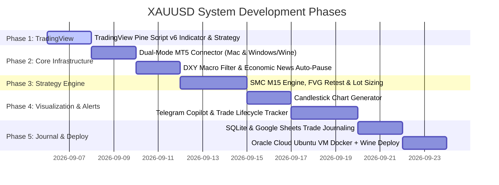

# 🗺️ Master Roadmap: XAUUSD Trading Copilot & Indicator System

**Project:** XAUUSD Scalper & Institutional Signal Copilot  
**Target Asset:** Spot Gold (XAUUSD)  
**Target Broker:** Exness (Standard Account, MT5)  
**Current Date:** 2026-09-06  

---

## Executive Summary

This master plan coordinates the development of an institutional-grade Gold trading system comprising two complementary interfaces:
1. **TradingView Visual Copilot:** A custom Pine Script v6 Indicator & Strategy that plots Asian Session ranges, London/NY Killzones, dynamic ATR Stop Loss / Take Profit, and Chandelier trailing exits directly on TradingView charts.
2. **24/5 Autonomous Python Signal Copilot:** A headless Python daemon deployed via Docker + Wine on an Oracle Cloud Ubuntu Linux VM. It connects to Exness MT5, filters high-impact USD economic events, confirms H1 DXY trend momentum, executes SMC confluence logic, renders dark-theme candlestick charts, and sends real-time trade signals and lifecycle alerts (TP1, Breakeven, TP2, SL) to Telegram.

---

## Phase Breakdown & Status Tracker

| Phase | Component | Key Deliverables | Status | Primary Doc |
| :---: | :--- | :--- | :---: | :--- |
| **01** | **TradingView Pine Script v6** | Bidirectional trading (Long & Short), Dynamic ATR SL/TP, Killzones, Asian Range box, Exness spread model, Webhook alerts | 🟡 **IN PROGRESS** | [`04_TRADINGVIEW_INDICATOR_PLAN.md`](file:///Users/nopparuj/my-agents/XAUUSD_Scalper/plans/04_TRADINGVIEW_INDICATOR_PLAN.md) |
| **02** | **MT5 Connector & Macro Safety** | Dual-mode connector (macOS local mock + Windows/Wine live MT5), H1 DXY trend gate, High-impact USD news auto-pause (30 min window) | ⚪ READY (Ticket 01, 02) | [`03_IMPLEMENTATION_TICKETS.md`](file:///Users/nopparuj/my-agents/XAUUSD_Scalper/plans/03_IMPLEMENTATION_TICKETS.md) |
| **03** | **SMC Strategy Engine** | Asian range liquidity sweeps, M15 Market Structure Shift (MSS), Fair Value Gap (FVG) retest entry, Exness spread-compensated lot size calculator | ⚪ READY (Ticket 03) | [`01_SOTA_ARCHITECTURE_PLAN.md`](file:///Users/nopparuj/my-agents/XAUUSD_Scalper/plans/01_SOTA_ARCHITECTURE_PLAN.md) |
| **04** | **Chart Engine & Telegram Copilot** | In-memory M15 dark-theme candlestick chart renderer, Rich Telegram cards with copyable prices, Trade lifecycle tracker (TP1/BE/TP2/SL) | ⚪ READY (Ticket 04, 05) | [`02_SYSTEM_SPECIFICATION.md`](file:///Users/nopparuj/my-agents/XAUUSD_Scalper/plans/02_SYSTEM_SPECIFICATION.md) |
| **05** | **Trade Journaling & Analytics** | Local SQLite persistent storage, CSV journal, automated Google Sheets sync for Win Rate & Profit Factor auditing | ⚪ READY (Ticket 06) | [`03_IMPLEMENTATION_TICKETS.md`](file:///Users/nopparuj/my-agents/XAUUSD_Scalper/plans/03_IMPLEMENTATION_TICKETS.md) |
| **06** | **Oracle VM Cloud Deployment** | Automated 4 GB Swap setup script, Ubuntu 22.04 + Wine + Xvfb Docker container, 24/5 headless background execution | ⚪ READY (Ticket 07) | [`01_SOTA_ARCHITECTURE_PLAN.md`](file:///Users/nopparuj/my-agents/XAUUSD_Scalper/plans/01_SOTA_ARCHITECTURE_PLAN.md) |

---

## Directory of Plan Documents

- **[`01_SOTA_ARCHITECTURE_PLAN.md`](file:///Users/nopparuj/my-agents/XAUUSD_Scalper/plans/01_SOTA_ARCHITECTURE_PLAN.md)**: Deep technical architecture, mathematical spread-drag analysis for Exness Standard, and SOTA SMC institutional logic.
- **[`02_SYSTEM_SPECIFICATION.md`](file:///Users/nopparuj/my-agents/XAUUSD_Scalper/plans/02_SYSTEM_SPECIFICATION.md)**: Complete system specifications containing the 23 user stories, architecture decisions, and high-level testing seams.
- **[`03_IMPLEMENTATION_TICKETS.md`](file:///Users/nopparuj/my-agents/XAUUSD_Scalper/plans/03_IMPLEMENTATION_TICKETS.md)**: Catalog of the 7 modular tracer-bullet vertical slice tickets with dependency graphs and acceptance criteria.
- **[`04_TRADINGVIEW_INDICATOR_PLAN.md`](file:///Users/nopparuj/my-agents/XAUUSD_Scalper/plans/04_TRADINGVIEW_INDICATOR_PLAN.md)**: Detailed engineering design for upgrading the user's Pine Script v6 strategy into an institutional Gold tool.
