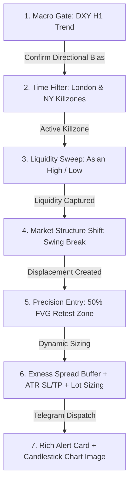

# 🏆 SOTA Architecture Plan: High Win-Rate XAUUSD Copilot

**System:** XAUUSD Institutional Signal Copilot  
**Broker:** Exness Standard (MT5, Symbol `XAUUSD`)  
**Deployment:** Oracle Cloud Free Tier Ubuntu VM (Docker + Wine) + macOS Local Dev  

---

## 1. Resource Feasibility Analysis

### 1.1 Local Development Machine: macOS
- **Technical Reality:** The official `MetaTrader5` Python package publishes compiled C-extensions solely for Windows (`mt5.pyd`). It cannot be imported on macOS.
- **Architecture Solution:** Dual-Mode MT5 Connector (`scripts/mt5_connector.py`):
  - *Production Mode:* Binds to native MT5 via Windows IPC when executed under Wine or Windows.
  - *Dev / Simulation Mode:* Automatically switches to offline historical data playback using local CSV snapshots (`data/XAUUSD_M15.csv`) and `yfinance` without throwing runtime errors.

### 1.2 Cloud Host: Oracle Cloud Free Tier (Ubuntu Linux)
- **Technical Reality:** AMD Micro instances (`VM.Standard.E2.1.Micro`) offer 1/8 OCPU and 1 GB of physical RAM. Running Xvfb + Wine + MT5 + Python simultaneously can trigger Out-Of-Memory (OOM) kills if unmanaged.
- **Architecture Solution:** Automated 4 GB Swap File allocation script (`deploy/setup_oracle_swap.sh`) utilizing the instance's 50 GB free NVMe boot volume, coupled with a minimal headless Docker container running `xvfb` and Wine.

### 1.3 Broker Reality: Exness Standard Floating Spread
- **Technical Reality:** Gold spreads on Exness Standard float between 25 and 35 points ($0.25–$0.35). Entering trades by chasing candle closes produces an adverse Realized R:R of ~1:4 after spread deductions.
- **Architecture Solution:** Never chase extended closes. Orders are calculated as **Limit/Retest entries into Fair Value Gaps (FVG)** at the 50% midpoint. This constrains Stop Loss to 20–30 points ($2–$3) and widens Take Profit to 60–120 points ($6–$12), securing an effective R:R of **1:2.5 to 1:4.0** net of spread.

---

## 2. Institutional SMC Trading Engine (2025/2026 SOTA)

### Core Analytical Components
1. **Killzones (Time-based Liquidity):**
   - London Open Killzone: 07:00 – 10:00 UTC (14:00 – 17:00 TH)
   - New York Open Killzone: 12:30 – 15:30 UTC (19:30 – 22:30 TH)
   - Outside these windows, signal generation is suspended.
2. **Session Liquidity Engine:**
   - Tracks the **Asian Session Range (00:00–07:00 UTC)** High/Low and Previous Day High/Low (PDH/PDL).
   - Signals trigger after price sweeps outside the Asian range and rejects back inside.
3. **True Market Structure Shift (MSS):**
   - Requires candle body closes beyond the opposing 3–5 candle swing pivot.
4. **Fair Value Gap (FVG) Retest:**
   - Calculates the 3-candle imbalance gap and sets Entry at the 50% Consequent Encroachment level.
5. **DXY (US Dollar Index) Macro Gate:**
   - H1 DXY Bullish -> Gold BUY blocked.
   - H1 DXY Bearish -> Gold SELL blocked.
6. **Exness Spread Guard:**
   - Real-time spread check: Signals aborted if spread exceeds 35 points. SL and Breakeven levels are buffered with `spread + 5 points`.

---

## 3. System Architecture & Component Mapping

| Subsystem | File Path | Core Responsibility |
| :--- | :--- | :--- |
| **Config Hub** | `config/settings.yaml` | Runtime settings for MT5, SMC thresholds, Killzones, risk %, news, and Telegram |
| **Config Loader** | `scripts/config_loader.py` | Schema validation, environment variable override, logging setup |
| **MT5 Connector** | `scripts/mt5_connector.py` | Dual-mode connector (Windows/Wine live MT5 + macOS offline simulation) |
| **DXY Service** | `scripts/dxy_service.py` | H1 US Dollar Index trend evaluation and macro directional gating |
| **News Service** | `scripts/news_service.py` | Economic calendar parser with 30-minute pre/post high-impact USD auto-pause |
| **SMC Strategy** | `scripts/strategy.py` | Asian range calculation, sweep detection, MSS, FVG detection, and lot sizing |
| **Chart Generator** | `scripts/chart_generator.py` | Headless matplotlib dark-theme candlestick chart renderer outputting PNG bytes |
| **Trade Tracker** | `scripts/trade_tracker.py` | Active trade state machine tracking milestones (`TP1_REACHED`, `TP2_REACHED`, `SL_HIT`) |
| **Notifier** | `scripts/notifier.py` | Telegram photo and rich text dispatch |
| **Insight Formatter** | `scripts/insight_formatter.py` | Monospaced copyable alert card formatting with spread checks |
| **Trade Logger** | `scripts/trade_logger.py` | Persistent trade audit logging to SQLite (`data/trades.db`) and CSV |
| **GWS Logger** | `scripts/gws_logger.py` | Google Sheets trading journal synchronization |
| **Deployment** | `deploy/` | Dockerfile, docker-compose.yml, entrypoint.sh, setup_oracle_swap.sh |
| **Orchestrator** | `main.py` | Master asynchronous loop integrating all services |
