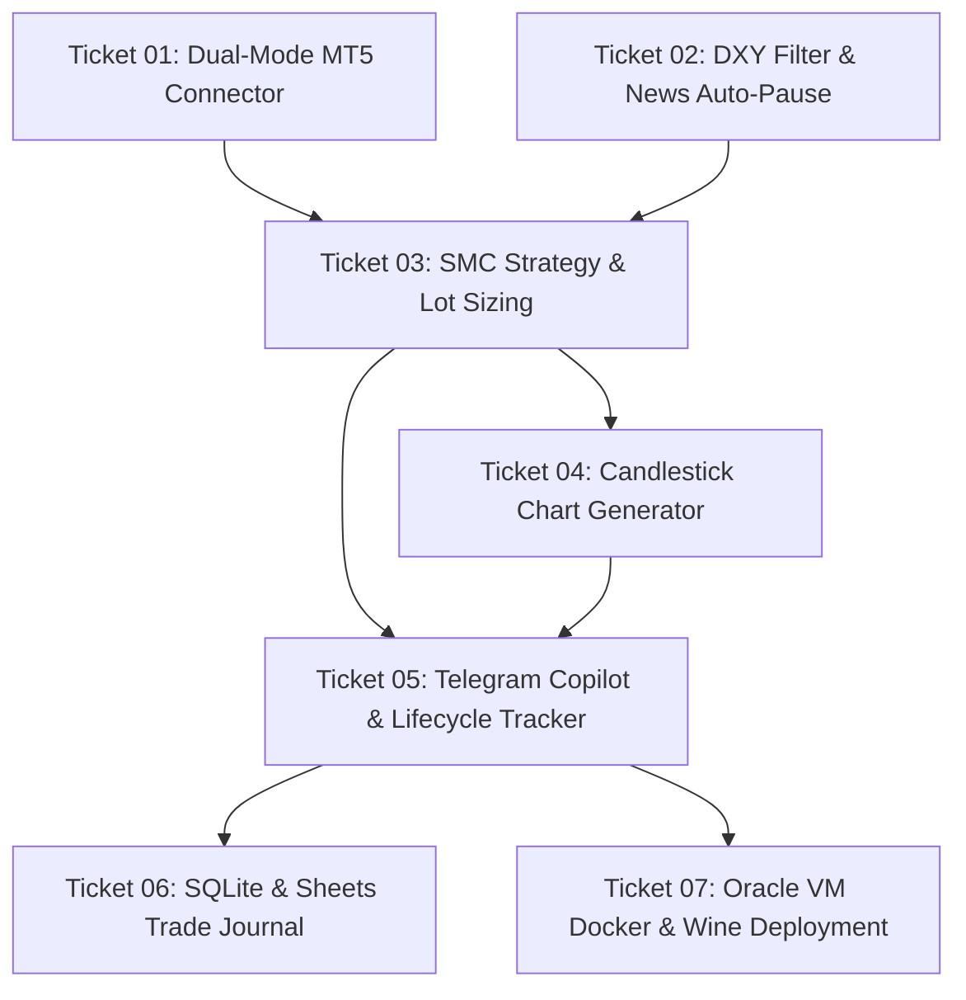

# 🎟️ Implementation Tickets: Vertical Slices & Dependency Graph

**Project:** XAUUSD Scalper & Copilot  
**Status:** Frontier Active  
**Issue Folder:** `.scratch/xauusd-copilot/issues/`  

---

## Dependency Graph

---

## Ticket Catalog

### 01 — Dual-Mode MT5 & Account Connector with Mock/Local Fallback
- **File:** [`.scratch/xauusd-copilot/issues/01-dual-mode-mt5-connector.md`](file:///Users/nopparuj/my-agents/XAUUSD_Scalper/.scratch/xauusd-copilot/issues/01-dual-mode-mt5-connector.md)
- **Blocked by:** None — **Frontier (Can start immediately)**
- **Deliverable:** Environment-aware market data bridge that operates in mock/simulation mode on macOS and binds to live Exness MT5 on Windows/Wine.
- **Acceptance Criteria:**
  - Auto-detects OS and runs mock mode on macOS without errors.
  - Fetches M15, H1, H4 candles as clean pandas DataFrames.
  - Queries live equity, balance, and floating spread.
  - Passes all unit tests with 100% success rate.

### 02 — DXY Macro Trend Filter & Economic News Auto-Pause Engine
- **File:** [`.scratch/xauusd-copilot/issues/02-dxy-filter-and-news-pause.md`](file:///Users/nopparuj/my-agents/XAUUSD_Scalper/.scratch/xauusd-copilot/issues/02-dxy-filter-and-news-pause.md)
- **Blocked by:** None — **Frontier (Can start immediately)**
- **Deliverable:** Macro gate evaluating H1 DXY trend and economic calendar parser with 30-minute pre/post news auto-pause.
- **Acceptance Criteria:**
  - Fetches H1 DXY and outputs directional bias (`BULLISH`, `BEARISH`, `NEUTRAL`).
  - Blocks opposing Gold signals during strong DXY expansion.
  - Identifies USD High-Impact ("Red Folder") events and returns `is_safe_to_trade() == False` within window.
  - Formats daily morning news summary for Telegram.

### 03 — SMC M15 Strategy Engine with FVG Retest & Spread-Compensated Lot Sizing
- **File:** [`.scratch/xauusd-copilot/issues/03-smc-strategy-and-lot-sizing.md`](file:///Users/nopparuj/my-agents/XAUUSD_Scalper/.scratch/xauusd-copilot/issues/03-smc-strategy-and-lot-sizing.md)
- **Blocked by:** Ticket 01, Ticket 02
- **Deliverable:** Core SMC strategy engine calculating Asian Range, Killzone filters, liquidity sweeps, true MSS, FVG retest zones, spread-buffered SL/TP, and equity-based lot sizing.
- **Acceptance Criteria:**
  - Identifies Asian range (00:00–07:00 UTC) High and Low.
  - Restricts execution to London (07:00–10:00 UTC) and NY (12:30–15:30 UTC) Killzones.
  - Detects liquidity sweep beyond Asian levels with rejection wick.
  - Requires true MSS breaking recent swing pivot.
  - Identifies FVG and sets Entry at 50% Consequent Encroachment.
  - Dynamically calculates lot size from live equity for 1–2% risk.

### 04 — Visual M15 Candlestick Chart Generator
- **File:** [`.scratch/xauusd-copilot/issues/04-candlestick-chart-generator.md`](file:///Users/nopparuj/my-agents/XAUUSD_Scalper/.scratch/xauusd-copilot/issues/04-candlestick-chart-generator.md)
- **Blocked by:** Ticket 03
- **Deliverable:** Headless in-memory matplotlib candlestick chart renderer with Asian Range box, sweep marker, FVG zone, and color-coded Entry/TP/SL lines.
- **Acceptance Criteria:**
  - Clean dark-theme layout using headless `Agg` backend.
  - Visual overlays for Asian Range, FVG zone, and Entry/SL/TP levels.
  - Returns `io.BytesIO` PNG bytes directly without disk I/O.

### 05 — Rich Telegram Copilot & Active Trade Lifecycle Tracker
- **File:** [`.scratch/xauusd-copilot/issues/05-telegram-copilot-lifecycle-tracker.md`](file:///Users/nopparuj/my-agents/XAUUSD_Scalper/.scratch/xauusd-copilot/issues/05-telegram-copilot-lifecycle-tracker.md)
- **Blocked by:** Ticket 03, Ticket 04
- **Deliverable:** Telegram dispatch with monospaced copyable numbers and chart photo, coupled with asynchronous state machine tracking active setups to emit follow-ups when TP1, TP2, or SL is hit.
- **Acceptance Criteria:**
  - Dispatches structured Telegram alert card with photo attachment.
  - Tracks `WAITING_ENTRY` -> `ACTIVE` -> `TP1_REACHED` -> `TP2_REACHED` / `SL_HIT`.
  - Sends alert upon TP1 advising 50% partial take and moving SL to spread-buffered Breakeven.
  - Sends completion alert on TP2 or SL.

### 06 — Automated Trade Journaling (Local SQLite & Google Sheets)
- **File:** [`.scratch/xauusd-copilot/issues/06-trade-journal-sqlite-sheets.md`](file:///Users/nopparuj/my-agents/XAUUSD_Scalper/.scratch/xauusd-copilot/issues/06-trade-journal-sqlite-sheets.md)
- **Blocked by:** Ticket 05
- **Deliverable:** Persistent audit logger saving every trade setup and outcome into SQLite (`data/trades.db`), CSV, and Google Sheets.
- **Acceptance Criteria:**
  - Creates SQLite `trades` schema and inserts signals.
  - Updates record on trade resolution with exit price, hold time, and PnL in R.
  - Mirrors journal entries to Google Sheets when enabled.
  - Provides Win Rate and Profit Factor summary metrics.

### 07 — Headless Docker + Wine Deployment for Oracle Cloud Ubuntu VM
- **File:** [`.scratch/xauusd-copilot/issues/07-oracle-vm-docker-deployment.md`](file:///Users/nopparuj/my-agents/XAUUSD_Scalper/.scratch/xauusd-copilot/issues/07-oracle-vm-docker-deployment.md)
- **Blocked by:** Ticket 05
- **Deliverable:** Turnkey deployment bundle with 4 GB Swap setup script, Dockerfile, docker-compose.yml, and runbook for Oracle Cloud Free Tier Ubuntu instances.
- **Acceptance Criteria:**
  - Shell script allocating 4 GB swap file on Ubuntu to prevent OOM errors.
  - Docker container running Xvfb virtual display + Wine + MT5 + Python daemon.
  - Volumes mounted for configs, logs, and database with restart policy.
