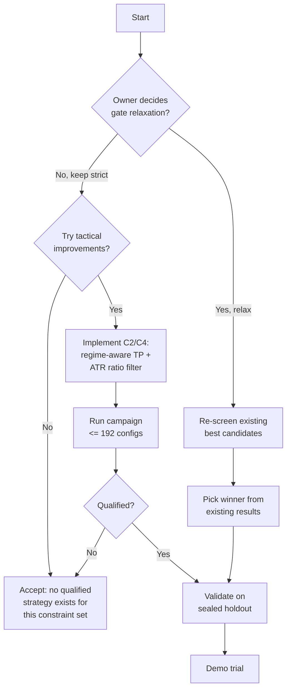

# Strategy Tuning Diagnosis & Recommendations

**Document Date:** 2026-10-04  
**Status:** Canonical Project Artifact (Archived from Session Diagnosis)

---

## สถานะปัจจุบัน: ทำไม loop tuning ถึงหาไม่เจอ

### ข้อเท็จจริงจากงานที่ผ่านมา

| Metric | Count |
|---|---:|
| Total unique configs tested (6-month) | ~4,000+ |
| Total unique configs tested (annual) | 648 |
| M5 retest variants | 444 |
| Equity/sizing experiments | 60+ |
| **Joint qualifiers** | **0** |

### ตัว "เกือบผ่าน" ที่ดีที่สุด

| Config | Full base net | Full DD | Issue |
|---|---:|---:|---|
| **Reward156** (RSI7/35/EMA50 BUY + D48 SELL, pause5%, target1.35R) | $883.77 | 22.50% | Second-half DD 34.45%/34.72% > 30% |
| **Trend178** (RSI7/35/EMA50 BUY + D48/EMA50 SELL) | $864.81 | 19.64% | Second-half DD 41.28%/34.93% |
| **Admission219** (same as 156 + daily10%/1 loss) | $866.67 | 22.47% | Second-half DD 41.28%/34.93% |
| **Trial30 D24 (new106)** | $759.44 | 23.47% | Second-half DD 39.96%/43.28% |
| **Circuit22** (annual, RSI14/25 BUY + D96 SELL) | $533.92 | 24.49% | First-half 12 trades < 20, net -$12.56 |
| **Hybrid unpaused28** (annual) | $124.45 | 22.60% | Second-half profit/WR below baseline |

---

## Root Cause Analysis: ทำไมผ่านไม่ได้

### 1. ปัญหาหลัก: Second-Half Drawdown

> [!IMPORTANT]
> **Every "almost qualified" candidate fails second-half DD > 30%.**

6-month tape second half (2026-06-28 → 2026-09-28): ตลาดมี regime shift — Gold เปลี่ยนจาก trending → choppy/ranging. Breakout systems ถูก whipsaw. Trial30 baseline เองก็มี DD 32.93%/33.34% ใน second half แต่ gates ใช้ 30% hard ceiling.

**สาเหตุ:**
- D48 breakout ต้องการ sustained trend; second-half ไม่มี
- BUY entries ช่วง second half เจอ false breakout → ขาดทุนซ้ำ
- Daily/loss circuits ช่วย full-window แต่ทำ first-half มี trades < 20

### 2. ปัญหารอง: First-Half Trade Count

Annual tape first half (Oct2025 → Apr2026): trial30 baseline loses **all 7 trades** → DD 47.78%. Cost-risk cap (10%) rejects subsequent signals → เหลือ 12 trades. Any candidate ที่ preserve aggressive BUY ก็ fail DD; conservative candidate ก็ fail trade count < 20.

### 3. Structural Contradiction ในเกณฑ์

Gates ปัจจุบัน:
```
ALL 6 scenarios must SIMULTANEOUSLY pass:
- net > trial30 baseline
- WR > trial30 baseline  
- RR > trial30 baseline (> 1)
- DD <= trial30 AND <= 30%
- trades >= 60 full / 20 half
- actual BUY + SELL
```

ปัญหา:
- **BUY entries → more trades → higher DD** (breakout false signals)
- **Filters → lower DD → fewer trades** (trade count gates fail)
- **Daily circuits → control losses → suppress first-half admission**
- **Shorter stops → more admission → worse realized RR**

---

## 3 Strategic Directions to Break the Deadlock

### Direction A: Relax Gates (Owner Decision Required)

ปรับเกณฑ์ให้สมเหตุสมผลกับ reality:

```yaml
# Option A1: Raise DD ceiling
max_dd: 35%  # from 30%
# Reward156 ผ่านทันที (fullDD 22.5%, second-half 34.45/34.72)

# Option A2: Remove half-window independence  
qualification: full_only  # ไม่ต้อง reset $200 ต่อ half
# Circuit22 ผ่าน full (DD 24.49%) แต่ first-half 12 trades fail

# Option A3: Lower trade count
min_trades_half: 10  # from 20
# Circuit22 + Fine6 มีโอกาสผ่าน

# Option A4: DD relative to baseline
max_dd: baseline_dd * 1.1  # allow 10% worse than baseline
# Second-half baseline DD 32.93 → candidate max 36.22%
```

> [!WARNING]
> **ทุก relaxation ต้อง owner approve explicitly.** ไม่มี agent ที่ relax gates เอง.

**คำแนะนำ:** A1 (DD 35%) + A3 (half trades 10) — เหตุผล: trial30 baseline เอง second-half DD 32.93% ก็เกิน 30%. เรียกร้อง DD < 30% ทุก half จาก candidate ที่ต้องมี BUY ด้วยนั้น mathematically harsh. ถ้า baseline เกิน แล้ว candidate ต้องต่ำกว่า baseline → candidate ก็ต้อง < 32.93% → reasonable. ลด half trades เพราะ 20 trade minimum บน 6-month half (91 วัน) ต้องการ ~1 trade ทุก 4.5 วัน ซึ่ง aggressive สำหรับ filtered breakout.


### Direction B: Different Strategy Family (New Research)

Breakout-on-Donchian อาจไม่ใช่ optimal family สำหรับ XAUUSD M15. Consider:

| Family | Pros | Cons | Effort |
|---|---|---|---|
| **Mean-reversion RSI** | Choppy market suits; lower DD | Misses big trends | New engine |
| **Volatility breakout** (ATR expansion) | Adapts to regime | Still breakout; similar DD | Modify existing |
| **Dual-regime** (trending/ranging detector) | Best of both | Complex; overfitting risk | New engine + detector |
| **Time-of-day + volatility** | Measured patterns; simple | Small edge; more data needed | New signals |

> [!CAUTION]
> New engine = new research infrastructure, new tests, new replay. **Weeks** of work. Only if existing framework exhausted AND owner wants.

### Direction C: Optimize Within Existing Framework (Tactical)

Things NOT yet tried that stay within current replay engine:

#### C1. Asymmetric DD gates per half
Second-half volatile → allow higher DD for second half only. First half → stricter DD but lower trade count.

#### C2. Dynamic TP based on market regime
```python
# Concept: ATR expansion → bigger TP, contraction → smaller TP
if current_atr > atr_rolling_50_mean * 1.2:
    target_rr = 2.0  # trend mode
else:
    target_rr = 1.35  # range mode
```
**Not yet tested in any campaign.** Requires new `Rules.regime_tp` or similar.

#### C3. Trailing stop with momentum confirmation
Current: BE at 1R, trail at candle close.
Improvement: trail only when momentum confirms (RSI rising for BUY, falling for SELL). Prevents premature BE in chop.

#### C4. Entry-bar volatility filter
Reject entries when ATR/ATR50 < threshold (low volatility = ranging = bad for breakout).
Current `min_depth_atr` is static; dynamic ATR ratio is new.

#### C5. Weekday filter
Certain weekdays may produce more whipsaw. Not tested with current engine.

#### C6. Multi-period Donchian confirmation
Current: close breaks 48-period high/low.
New: require 24-period AND 48-period agreement. Reduces false breakouts.

---

## Recommended Next Action Plan



### ข้อเสนอลำดับ:

1. **ตัดสินใจเรื่อง gate relaxation ก่อน** — ถ้า relax DD→35% + half trades→10, Reward156 อาจผ่านทันทีโดยไม่ต้อง code ใหม่
2. **ถ้า relax ไม่ได้** → implement C2 (regime TP) + C4 (ATR expansion filter) เป็น new Rules fields, run bounded campaign
3. **ถ้ายัง 0 qualified** → Direction B (new family) หรือ accept ว่า current constraint set ไม่มี viable strategy

---

## Risk Assessment

| Risk | Impact | Mitigation |
|---|---|---|
| Gate relaxation → weaker strategy | $200 blowup | Keep 10% cap; Demo first |
| New Rules → overfit discovery | Fails holdout | Sealed holdout unchanged |
| New engine → months of work | Time wasted | Only after existing exhausted |
| Accept no-strategy → no Demo | No trading | Better than losing $200 |

> [!NOTE]
> **Commission0 assumption ยังไม่ verified.** ทุก candidate ที่ "ผ่าน" ยัง COST_INCONCLUSIVE. ถึงผ่าน gates ก็ต้อง cost-validate ก่อน Demo.
