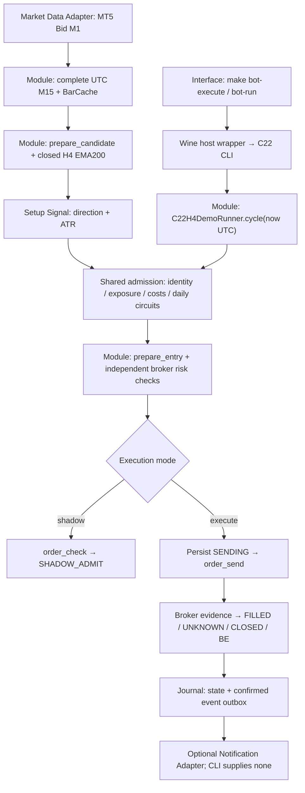

# Trading logic consistency recheck — 2026-10-12

ตรวจแล้ว: **C22 entry/filter สอดคล้องกับ frozen contract ทั้ง BUY และ SELL** ไม่พบเงื่อนไขฝั่งตรงข้ามถูก AND เข้า signal เดียวกันในเส้นทางที่ตรวจ แต่พบข้อจำกัด day-start baseline หลังถือข้ามสอง UTC midnights และช่องว่างระหว่างเอกสารกับ implementation. ความสอดคล้องของกฎยังไม่พิสูจน์กำไรสุทธิหรือ broker parity.

ตรวจ local HEAD `f64d7da8e10270ebb47893f2b14f48481cf8cdc6`. การเปลี่ยน `CONTEXT.md` และ `data/c22h4-demo-trades.md` มีอยู่ก่อนรีวิวและคงไว้. ไม่แก้ strategy/config/source pins, ไม่เปิด MT5/Wine, ไม่รัน watcher, ไม่ส่งคำสั่ง broker จริง. Reproduction ใช้ synthetic bars และ broker fixtures เท่านั้น. ไม่ทำ economic backtest ใหม่.

## Intent และทางเลือกเล็กสุด

เป้าหมาย: ยืนยันว่า Setup Signal, admission, geometry, protection และบัญชีผลปิดของ C22 ใช้ contract ที่เข้ากัน พร้อมแยก research/rollback/legacy ที่มีกฎต่างกัน.

ทางเลือกเล็กสุด: **คง C22 detector/geometry เดิม ใช้ strategy seam และ shared lifecycle ที่มีอยู่** แล้วแก้ความคลุมเครือของ baseline policy/เอกสาร. การเพิ่ม filter ทุก strategy เข้า C22 หรือสร้าง module กลางใหม่ทันทีเพิ่ม scope และเปลี่ยน frozen contract โดยไม่มีหลักฐานผลกำไรรองรับ. C22 ใช้ `C22H4Strategy` เป็น Adapter ให้ `Trial30DemoRunner`; Trial30 เป็นอีก Adapter ที่มีอยู่จริง ([runner.py](/Users/nopparuj/my-agents/XAUUSD_Scalper/scripts/c22h4/runner.py:153), [shared runner](/Users/nopparuj/my-agents/XAUUSD_Scalper/scripts/trial30/runner.py:43)).

## Module map และ Interface

- Operator Interface: [Makefile:99](/Users/nopparuj/my-agents/XAUUSD_Scalper/Makefile:99), [C22 wrapper:7](/Users/nopparuj/my-agents/XAUUSD_Scalper/scripts/ops/run_c22h4_wine.py:7), [C22 CLI:15](/Users/nopparuj/my-agents/XAUUSD_Scalper/scripts/ops/mt5_wine_c22h4.py:15). `bot-run` เป็น shadow เมื่อ env gate ไม่ใช่ `1`; env gate `1` เปลี่ยนเป็น execute. `bot-execute` ตั้ง gate เอง.
- Market Data Interface: aware UTC, ordered Bid M1, M15 ครบ 15 นาที, H4 ครบ 16 M15 bars, cache overlap ต้องตรง. Seam นี้แชร์กับ research ผ่าน bar/indicator functions ([broker_data.py:95](/Users/nopparuj/my-agents/XAUUSD_Scalper/scripts/pure_b1/broker_data.py:95), [BarCache:83](/Users/nopparuj/my-agents/XAUUSD_Scalper/scripts/c22h4/strategy.py:83), [closed_h4_ema:49](/Users/nopparuj/my-agents/XAUUSD_Scalper/scripts/research/reward156_tuning.py:49)).
- Strategy Interface: `frame`, `levels`, `protects`, `diagnostics`; implementation อยู่ใน C22 Adapter. `cycle(now)` มี Depth: caller ได้ admission, persistence, reconciliation และ protection ผ่าน Interface เดียว. Shared implementation เพิ่ม Leverage/Locality โดยคง strategy-specific hooks ([C22H4Strategy:56](/Users/nopparuj/my-agents/XAUUSD_Scalper/scripts/c22h4/runner.py:56), [cycle:85](/Users/nopparuj/my-agents/XAUUSD_Scalper/scripts/trial30/runner.py:85)).
- Execution/Journal Interface: fixed volume, explicit Demo identity, durable SENDING ก่อน send, UNKNOWN ต้องรอ evidence, confirmed events commit กับ state. Telegram ไม่ได้เปิดใน CLI นี้; outbox ไม่เท่ากับส่ง Telegram แล้ว ([admission:210](/Users/nopparuj/my-agents/XAUUSD_Scalper/scripts/trial30/runner.py:210), [reconcile:331](/Users/nopparuj/my-agents/XAUUSD_Scalper/scripts/trial30/runner.py:331), [Journal:42](/Users/nopparuj/my-agents/XAUUSD_Scalper/scripts/trial30/journal.py:42), [CLI:121](/Users/nopparuj/my-agents/XAUUSD_Scalper/scripts/ops/mt5_wine_trial30.py:121)).

## เงื่อนไข C22 ที่ยืนยันแล้ว

- **BUY:** rolling RSI14 จาก `<25` เป็น `>=25`, close delta บวก, M15 close > EMA50, EMA50 > EMA50 สี่แท่งก่อน, M15 close > EMA200 จาก H4 ที่ปิดแล้ว. RSI ใช้ rolling mean gain/loss; เปลี่ยนเป็น RSI สูตรอื่นแม้ period เท่ากันเปลี่ยน contract ([campaign_signals.py:72](/Users/nopparuj/my-agents/XAUUSD_Scalper/scripts/research/campaign_signals.py:72), [macro gate:208](/Users/nopparuj/my-agents/XAUUSD_Scalper/scripts/research/reward156_search.py:208)).
- **SELL:** M15 close < prior 96-bar low ที่ shift หนึ่งแท่ง, close < EMA50, EMA50 < EMA50 สี่แท่งก่อน, close < closed-H4 EMA200 ([campaign_signals.py:57](/Users/nopparuj/my-agents/XAUUSD_Scalper/scripts/research/campaign_signals.py:57)).
- BUY/SELL พร้อมกันเป็นไปไม่ได้ภายใต้ EMA50 guards นี้: close ต้องทั้ง `>` และ `<` EMA50. Generic SELL priority ยังอยู่. H4 gate วัด M15 close เทียบ closed-H4 EMA200; **ไม่มี H4 EMA slope gate หรือเงื่อนไขว่าทุก candle ต้องสีเดียวกัน** ([campaign_signals.py:85](/Users/nopparuj/my-agents/XAUUSD_Scalper/scripts/research/campaign_signals.py:85), [reward156_search.py:208](/Users/nopparuj/my-agents/XAUUSD_Scalper/scripts/research/reward156_search.py:208)).
- BUY SL 1.5ATR, TP 2 เท่าระยะ modeled entry ถึง rounded SL; protection off. SELL SL 2.5ATR, TP 3ATR: nominal price RR ประมาณ 1.2 ก่อนต้นทุน/rounding; SELL BE หลัง closed-bar first quote ถึง net-before-swap 1R ([Rules:217](/Users/nopparuj/my-agents/XAUUSD_Scalper/scripts/research/reward156_search.py:217), [prepare_entry:31](/Users/nopparuj/my-agents/XAUUSD_Scalper/scripts/research/breakout_entry.py:31), [BE:499](/Users/nopparuj/my-agents/XAUUSD_Scalper/scripts/trial30/runner.py:499)).
- Fixed 0.01, initial cost-inclusive cap 10% ของ current equity, daily circuit 10%, หนึ่ง losing completed exit ต่อ UTC exit day. Risk rejection เป็น veto ไม่ได้สร้าง signal ฝั่งตรงข้าม. ไม่มี lot clamp/recovery ในเส้นทางนี้ ([C22 constants:56](/Users/nopparuj/my-agents/XAUUSD_Scalper/scripts/c22h4/runner.py:56), [prepare_entry:85](/Users/nopparuj/my-agents/XAUUSD_Scalper/scripts/research/breakout_entry.py:85), [admission:149](/Users/nopparuj/my-agents/XAUUSD_Scalper/scripts/trial30/runner.py:149)).

Independent predicate probe เทียบ direction ทุกแถวของ synthetic fixtures 3,393/3,216 bars ตรงกับ detector. ได้ BUY 5 / SELL 1 ในคนละ fixture; ไม่ใช่ความถี่ตลาดจริง. BUY witness RSI14 `16.1375 → 26.6645`, close `201.2845 > EMA50 200.9511`, EMA50 สูงกว่าสี่แท่งก่อน `200.9034`, close เหนือ H4 EMA200 `159.8002`. จึงพิสูจน์ว่า RSI recovery กับ trend filter เกิดร่วมกันได้. นำ Pure B1 RSI30–70 มา AND จะ veto witness ที่ถูกต้องของ C22. ตรวจ geometry ทั้งฝั่ง, modeled commission/slippage และ rejection เมื่อ equity ไม่พอ; H4 prefix tests สามจุดไม่พบ lookahead difference. หลักฐาน: [probe.json](/Users/nopparuj/my-agents/XAUUSD_Scalper/runs/logic-recheck-2026-10-12/probe.json).

## Major: day-start latch ไม่ครอบคลุม daily continuity หลัง midnight ถัดไป

**Finding:** `_restart_baseline_latched` เป็น boolean ต่อ process; เมื่อเคย latch แล้ว วันถัดไปที่ถือข้าม midnight และพลาด first-second capture ไม่มี fallback อีก. Contract อนุมัติ process-scoped restart latch อยู่แล้ว; ข้อนี้คือข้อจำกัด operational continuity ที่ reproduce เพิ่ม ไม่ใช่เหตุให้ retune entry ([BrokerView:104](/Users/nopparuj/my-agents/XAUUSD_Scalper/scripts/trial30/broker.py:104), [approved policy](/Users/nopparuj/my-agents/XAUUSD_Scalper/CORE_STRATEGY.md:504)).

**ผลกระทบ:** ดูแล position/ยืนยัน close ต่อได้ แต่ new admission หลัง close ถูกบล็อก. ตอนมี active position `_cycle` กลืน baseline ValueError; ตอน flat error เดียวกันกลายเป็น BLOCKED ([active path:125](/Users/nopparuj/my-agents/XAUUSD_Scalper/scripts/trial30/runner.py:125), [flat path:139](/Users/nopparuj/my-agents/XAUUSD_Scalper/scripts/trial30/runner.py:139)).

**Evidence:** public C22 cycle กับ real cache/detector และ temporary persisted journal: `FILLED → MANAGING(day1, baseline190) → MANAGING(day2, baselineยังday1) → CLOSED → BLOCKED(day_start_floating_unknown)`. Macro/cache พร้อม; debugger ที่ `broker.py:120` เห็น `held=True`, latch `True`, persisted day เป็นวันก่อนหน้า. Restart control ด้วย broker/history เดิมได้ `WAIT(no_signal)` และ baseline ใหม่199; ไม่มี order resubmission. Probe สองรอบตรงกันทุกค่า. Assertion ที่คาด daily continuity ล้มตามจุดนี้ ([debugger.log](/Users/nopparuj/my-agents/XAUUSD_Scalper/runs/logic-recheck-2026-10-12/debugger.log), [red reproduction](/Users/nopparuj/my-agents/XAUUSD_Scalper/runs/logic-recheck-2026-10-12/continuity-red.log)).

Local trade note ยังบันทึก reason เดียวกันเมื่อ `2026-10-12T07:34:41.941401+00:00` ([trade note:1499](/Users/nopparuj/my-agents/XAUUSD_Scalper/data/c22h4-demo-trades.md:1499)). นี่เป็นหลักฐาน log ของ block ที่เกิดขึ้น ไม่ใช่ fresh broker query หรือข้อพิสูจน์ว่า runtime นั้นเกิดจาก multi-midnight latch เดียวกับ fixture. เก็บ excerpt/provenance ใน runs โดยไม่แก้ต้นฉบับ.

**Suggested change:** กำหนด recovery policy สำหรับแต่ละ UTC day ก่อนแก้ `BrokerView`; ทดสอบ public cycle ครอบคลุมหลาย midnight และ restart. ถ้าเลือกคง process-scoped policy ให้ระบุ block นี้ใน runbook. หากเลือก daily recovery ต้องมี baseline provenance/persistence และ owner review พร้อม CORE_STRATEGY update. ห้ามใช้ restart หรือ reset flag เป็นวิธีบังคับ trade เพราะเปลี่ยนฐาน daily allowance.

## ข้อจำกัดการพิสูจน์กำไร: modeled costs ยังไม่ใช่ broker parity

**Finding:** frozen BE trigger/stop ชดเชย commission และ declared slippage แต่ไม่ชดเชย accrued/future swap. Replay กับ Demo มี behavior นี้ร่วมกัน; net ปิดและ losing-exit circuit รวม swap แล้ว. BE exit จึง net ติดลบและบล็อกวันนั้นได้ โดยไม่เป็น contradiction ของ code ([replay BE:362](/Users/nopparuj/my-agents/XAUUSD_Scalper/scripts/research/breakout_replay.py:362), [live BE:515](/Users/nopparuj/my-agents/XAUUSD_Scalper/scripts/trial30/runner.py:515), [cash ledger:13](/Users/nopparuj/my-agents/XAUUSD_Scalper/scripts/trial30/broker.py:13), [loss count:288](/Users/nopparuj/my-agents/XAUUSD_Scalper/scripts/trial30/runner.py:288)).

Research swap calendar ใช้ assumed UTC midnight; Exness ระบุ generic posting ที่ 21:00/22:00 UTC ตามฤดูกาล และเงื่อนไขขึ้นกับ instrument/account. ยังไม่ได้ตรวจ entitlement/rates/history ของบัญชีปัจจุบัน. ห้ามตีความ modeled current-spec swap เป็น actual broker parity ([rollover.py:11](/Users/nopparuj/my-agents/XAUUSD_Scalper/scripts/research/rollover.py:11), [Exness swap documentation](https://get.exness.help/hc/en-us/articles/360014709151-About-swap)). Successful `order_check` ก็ไม่ยืนยัน execution; lifecycle ที่ตรวจยังรอ broker evidence ([runner.py:224](/Users/nopparuj/my-agents/XAUUSD_Scalper/scripts/trial30/runner.py:224), [MQL5 order_check](https://www.mql5.com/en/docs/python_metatrader5/mt5ordercheck_py)).

**Suggested change:** คง COST_INCONCLUSIVE และ BE semantics เดิม; การเปลี่ยนให้ BE ชดเชย swap หรือ calendar ตาม broker ต้องเป็น contract/protocol ใหม่พร้อมหลักฐาน. ทุก economic evaluation ใหม่ต้อง base+swap และ stress+swap ไม่มี zero/no-swap fallback ([CORE_STRATEGY:517](/Users/nopparuj/my-agents/XAUUSD_Scalper/CORE_STRATEGY.md:517)).

รายงานย้อนหลังเดิมระบุ C22 base+swap net +291.55 USD, stress+swap +278.71 USD, DD39.28%/37.82% บนช่วง 2024-09-01 ถึง 2026-10-02. รีวิวนี้อ่านรายงาน ไม่ได้ rerun/re-audit historical ledger. ผลนั้นยังไม่ใช่ prospective qualification; daily baseline/actual-fill path ของ Demo มีความต่างที่ประกาศไว้ ([archived comparison](/Users/nopparuj/my-agents/XAUUSD_Scalper/docs/reviews/2026-10-04-four-strategy-continuous-backtest.md:20), [CORE_STRATEGY:500](/Users/nopparuj/my-agents/XAUUSD_Scalper/CORE_STRATEGY.md:500), [baseline distinction:662](/Users/nopparuj/my-agents/XAUUSD_Scalper/CORE_STRATEGY.md:662)).

## Medium: Unified Core Environment ยังไม่ใช่ implementation ปัจจุบัน

**Finding:** working-tree addition ใน `CONTEXT.md:76` อ้าง `scripts/core/`, `MarketDataProvider`, `TradingCostPolicy`, `RiskCircuitEngine` เป็น Single Source of Truth แต่ Codegraph ไม่พบ files/symbols และ filesystem ไม่มี `scripts/core/`. Actual path ยังเป็น C22 → trial30 lifecycle + canonical research functions ([CONTEXT:76](/Users/nopparuj/my-agents/XAUUSD_Scalper/CONTEXT.md:76), [actual imports](/Users/nopparuj/my-agents/XAUUSD_Scalper/scripts/c22h4/runner.py:9)).

**ผลกระทบ:** maintainer อาจเชื่อว่ารวม risk/cost/time policy แล้ว ทั้งที่ replay กับ Demo ยังมี Interface/invariants ต่างกัน.

**Suggested change:** ระบุ glossary entry นี้ว่า planned/proposed จนมี implementation และ public-interface parity evidence. เก็บ working-tree edit ของเจ้าของไว้; ไม่สร้าง module ที่ไม่มี caller เพื่อทำให้ข้อความดูจริง. Independent broker risk check ยังมีหน้าที่ตรวจ modeled calculation ไม่ควรลบทิ้งเพื่อรวม code ([runner.py:170](/Users/nopparuj/my-agents/XAUUSD_Scalper/scripts/trial30/runner.py:170), [broker check:186](/Users/nopparuj/my-agents/XAUUSD_Scalper/scripts/trial30/runner.py:186)).

## Strategy ที่ต้องแยก contract

- **Trial30 rollback:** D48 SELL-only, daily20%; C22 เปลี่ยน detector/circuits ผ่าน Adapter แต่ใช้ lifecycle เดิม. ห้ามรัน sender พร้อมกัน ([trial30_bars](/Users/nopparuj/my-agents/XAUUSD_Scalper/scripts/strategy.py:191), [retained rollback](/Users/nopparuj/my-agents/XAUUSD_Scalper/CORE_STRATEGY.md:504), [account guard test](/Users/nopparuj/my-agents/XAUUSD_Scalper/tests/test_c22h4_demo.py:362)).
- **Pure B1 research:** Donchian30 + RSI30–70 + EMA50, TP6.25ATR/SL2.5ATR ต่างจาก C22. Import `pure_b1_bars` เพื่อ validation ไม่ได้ทำให้ C22 ส่ง Pure B1 entries; archived C22 predicate ถูกสร้างใหม่ก่อน macro gate ([Pure B1](/Users/nopparuj/my-agents/XAUUSD_Scalper/scripts/strategy.py:23), [C22 prepare_candidate](/Users/nopparuj/my-agents/XAUUSD_Scalper/scripts/research/reward156_search.py:154)).
- **SMC M15 challenger:** sweep → aligned CHoCH → FVG → later retest → macro gate; เป็นลำดับหลายแท่งและ research-only. ไม่เอา wick-reversal/structure conditions มา AND กับ C22 breakout บนแท่งเดียวโดยอัตโนมัติ ([signals:150](/Users/nopparuj/my-agents/XAUUSD_Scalper/scripts/research/smc_challenger_signals.py:150), [macro:238](/Users/nopparuj/my-agents/XAUUSD_Scalper/scripts/research/smc_challenger_signals.py:238), [research contract](/Users/nopparuj/my-agents/XAUUSD_Scalper/CORE_STRATEGY.md:618)).
- **C22 frequency challengers:** เป็น research variations แยกจาก selected Demo contract; การลด filter/เพิ่ม frequency ไม่ qualify Demo โดยอัตโนมัติ ([CORE_STRATEGY:530](/Users/nopparuj/my-agents/XAUUSD_Scalper/CORE_STRATEGY.md:530)).

ขอบเขตเชิงลึกคือ C22/shared lifecycle/geometry/cost accounting. ตรวจ research adapters ที่เกี่ยวข้องเพื่อแยก contracts; ไม่ได้ audit legacy SMC/webhook/main ทุก branch หรือยืนยัน runtime/deployment ปัจจุบัน.

## Validation และสถานะ

- `make test`: **937 tests, 71.878s, OK (skipped=2)**. Suite เดิมผ่าน แต่ไม่ครอบคลุม stronger multi-midnight continuity assumption ที่ probe ใหม่แสดงว่าล้ม ([unit-tests.log](/Users/nopparuj/my-agents/XAUUSD_Scalper/runs/logic-recheck-2026-10-12/unit-tests.log)).
- `make compile deps lint format-check`: compile/deps/lint **PASS**; format-check **FAIL 13 existing files**. จึงไม่อ้าง aggregate `make check` ผ่าน. ไม่มีการ format source ที่ hash-pinned ([repository-checks.log](/Users/nopparuj/my-agents/XAUUSD_Scalper/runs/logic-recheck-2026-10-12/repository-checks.log)).
- `git diff --check`: **FAIL** จาก 1,170 CRLF/trailing-whitespace lines ใน trade-note additions ที่มีอยู่ก่อนรีวิว. Report ใหม่ผ่าน whitespace check; ไม่ normalize log ของเจ้าของ ([whitespace-check.log](/Users/nopparuj/my-agents/XAUUSD_Scalper/runs/logic-recheck-2026-10-12/whitespace-check.log)).
- Frozen contract/source hashes **PASS**; independent synthetic directions/geometry/cap rejection/H4 causality probes **PASS**, two complete probes **EXACT MATCH**. Diagnostic assertion `--expect-daily-continuity` **expected FAIL**, แสดง operational limit ที่ยังไม่แก้.
- Reproduce: `.venv/bin/python runs/logic-recheck-2026-10-12/logic_probe.py`; ใช้ `--expect-daily-continuity` เพื่อเห็น assertion ล้ม. Evidence/source hashes อยู่ใน [manifest.json](/Users/nopparuj/my-agents/XAUUSD_Scalper/runs/logic-recheck-2026-10-12/manifest.json). Raw outputs อยู่ใน ignored `runs/` เท่านั้น.
- ไม่รัน live MT5 connectivity/history/parity/shadow/cutover checks; current broker account, costs และ deployed process ยังไม่ verified โดยรีวิวนี้.

**Verdict: fix-then-ship สำหรับ operational continuity — daily baseline recovery หลัง midnight ถัดไปยังไม่ชัดครบ; directional entry contract ผ่าน แต่กำไรจริงยังไม่ qualified. รีวิวเสร็จ ไม่มี strategy/runtime change.**
