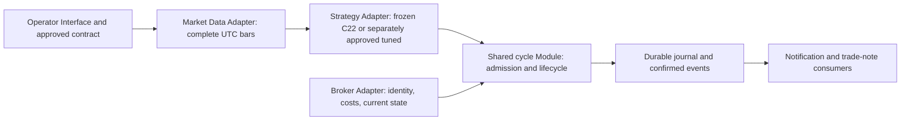

# C22 real-money readiness recheck — 2026-10-15

**Verdict: FIX-THEN-VALIDATE / real-money NO-GO.** Found two reproducible execution-operability gaps, plus missing strategy-port, cost/execution parity and prospective evidence. This assessment does not change the Demo or authorize real orders.

Reviewed local `be2d90fd3cb12ae345d24c260df16d4033494327`. Scope: operator command → Wine CLI → complete Bid M1/M15/H4 data → C22 detection → admission/risk → submission → reconciliation/protection/closure → journal/outbox/trade notes. Compared current C22H4 with selected research case `81a78454baaffcd1`; inspected native EA's tester-only gate. Legacy SMC/webhook/B1 senders are outside this approved C22 path and are not independently certified by this review.

No terminal launch, broker connection, real order API, watcher restart, cost renewal, strategy modification, deployment, push or merge. All synthetic `order_send` calls below are test mocks. Machine artifacts: [audit directory](../../runs/real-money-readiness-2026-10-15/).

## Repository-defined profile

The repository already defines the reference profile; no new account assumptions are needed:

- [CORE_STRATEGY.md:13](../../CORE_STRATEGY.md#1-ข้อมูลพื้นฐาน-basic-info): USD200 capital base. “Micro-account” describes the small capital base; the verified account evidence below identifies Standard Demo, not a verified Standard Cent account.
- [Broker conditions audit](2026-09-29-xauusdm-broker-conditions-audit.md): Exness Standard Demo, USD, `XAUUSDm`, contract100oz/lot, minimum/step0.01, account/rate observations dated2026-09-29. These are archived Demo facts, not a fresh real-account attestation.
- [Current C22 config](../../config/c22h4-demo.json): fixed0.01, cost-inclusive initial risk cap10%, daily10%, one losing exit/UTC day, BUY protection off and SELL BE1R. Recovery absent.
- [Selected research config](../../config/research-c22-profitable-exits-81a78454baaffcd1.json): RSI7cross30, SELL48/TP1.35R, BUYTP2R, BE1R both sides, two losing exits/day. Its economic comparison deposit is USD200.
- Pure B1's daily40%, archived B1-FINAL deposits100/1173, and legacy `config/settings.yaml` values are different contracts. C22 CLI does not load the legacy YAML trading/risk settings. Changing that YAML does not tune C22. Current local Demo journal day baseline is USD1812.21; it is not the research initial deposit.

Real operation is deliberately prohibited at multiple seams: [CLI config check](../../scripts/ops/mt5_wine_c22h4.py#L15), [Demo identity](../../scripts/trial30/broker.py#L30), [Standard Demo cost policy](../../scripts/trial30/costs.py#L7). A synthetic real-account `trade_mode=2` is rejected before sending. These are working guards, not defects to bypass.

## P1 — Post-fill SL/TP drift can escape the initial contract checks

**Finding:** after `active.status == FILLED`, initial target/stop equality and broker loss/cap validation are skipped. General checks still reject missing SL/TP, wrong volume or wrong side; a nonzero widened stop or changed target can remain accepted.

Trace: [initial reconciliation checks](../../scripts/trial30/runner.py#L388) → already FILLED → [BUY protection-off return](../../scripts/trial30/runner.py#L465). Witness: synthetic BUY on USD200 fills normally, then an external change widens its stop to a USD100 price-only loss. Next public `cycle()` returns `MANAGING`, `safety_halt=None`, with no containment action. The admission budget was USD20. Changing the target alone also remains `MANAGING`. Negative control: removing SL entirely triggers `SAFETY_CLOSED` and persistent halt. The bot did not itself widen the stop; this tests external/manual/broker-state drift after initial confirmation.

Evidence: [probe cases](../../runs/real-money-readiness-2026-10-15/probe.json), exact whole-probe repeat verified. This does not show that a live broker performed such a change.

**Minimal correction:** define allowed stop transitions per contract, including approved BE tightening; detect wrong target, unexpected widening and invalid prices on every owned-position reconciliation. Preserve independent broker loss calculation. Agree response policy before extending automatic closes: existing safety-close behavior versus explicit halt/alert plus operator containment. Do not silently change the approved trading contract.

## P1 — Human-readable trade-note failure can terminate management

**Finding:** [C22 cycle](../../scripts/c22h4/runner.py#L163) calls `_record_trade_note()` after the shared lifecycle returns, outside its exception handling. `append_note()` errors escape; [watch CLI](../../scripts/ops/mt5_wine_trial30.py#L149) catches them outside the loop and exits.

Witness: synthetic broker confirms FILLED and persistent active state/event, then `append_note` raises injected `OSError`. Public cycle raises with one position still open and broker SL/TP intact. Existing server protection is not removed, but watcher-driven BE/reconciliation stops if this reaches the CLI. Control with note success returns FILLED normally. Pdb confirms FILLED state and one mock send immediately before the failing note call.

Evidence: [pdb trace](../../runs/real-money-readiness-2026-10-15/pdb-trade-note.log), [probe](../../runs/real-money-readiness-2026-10-15/probe.json).

**Minimal correction:** keep durable financial journal/intent failures fail-closed, but isolate Markdown/JSONL presentation failures from position management. Prefer an idempotent trade-note consumer of confirmed journal events with visible retry/error state. Test note failure after fill and after close, repeated recovery and restart; do not swallow journal failures as optional logging.

## Readiness blocker — Research winner is not an executable sender contract

Current [BarCache](../../scripts/c22h4/strategy.py#L74) prepares the hardcoded approved `CONTRACT`; [source verification](../../scripts/c22h4/strategy.py#L54) and CLI demand its exact identity. Current strategy also hardcodes one-loss/day and SELL-only BE in [C22H4Strategy](../../scripts/c22h4/runner.py#L56).

Loading the selected flat research JSON fails `source_drift`. Simply replacing a JSON file cannot enable RSI7/30, SELL48, two-loss/day or BUY BE. Native `FrequencyResearchEA.mq5` also requires actual `MQL_TESTER` at [OnInit](../../mql5/FrequencyResearchEA.mq5#L254); its C22 tuned comparator is not the later selected winner. It is not a real-account sender.

**Minimal path:** add a separately named tuned Strategy Adapter at the existing `frame/levels/protects/circuit` seam, retaining shared `cycle()` lifecycle and rollback. Require exact detector/geometry/BE/count/cash-rounding parity before a separately approved Demo cutover. Keep frozen source paths/bytes and old Demo contract intact. Do not create a second monolithic engine or a generic flag that bypasses Demo identity.

## Operational blocker — Signals existed, but readiness was blocked

Read-only SQLite backup at2026-10-15T16:35:38UTC: active=None, no safety halt, zero journal events, execute=true, last result WAIT/duplicate_bar. This is local evidence, not a live broker flatness check or proof of every historical process/account action.

- Cost policy reviewed2026-10-05T20:03:29UTC: about236.5hours old at capture, beyond the24h validity check. A valid synthetic signal with stale policy returns `cost_policy_invalid_or_stale` without sending.
- Local append-only records explicitly contain that rejection at2026-10-14T12:45:01.988701UTC and16:15:01.961921UTC; these align with two raw signal closes found in the exported cache.
- Recomputed frozen detector on the existing6700-bar cache, sinceOct5: current C22 has12 raw signals, all SELL; selected tuned config has23, all SELL. These are detector counts, not executable admissions, trades, profit or a new economic backtest. The full live admission path was not replayed for every signal.
- Historical blocks also include permissions, stale quotes, warmup, foreign exposure, unknown baseline and one cache divergence. Per-bar observations needed for a complete signal→admission attribution are not retained in these deduplicated trade notes. Later cache availability does not retroactively pass a zero-divergence shadow gate.
- `WAIT` is a cycle outcome. Costs are validated after a new signal; WAIT alone does not mean entry-ready. Never renew attestation by changing only its timestamp.

Evidence: [runtime snapshot summary](../../runs/real-money-readiness-2026-10-15/runtime-summary.json), [signal diagnostic](../../runs/real-money-readiness-2026-10-15/local-signal-diagnostic.json), [recorded blockers](../../runs/real-money-readiness-2026-10-15/recorded-blocker-evidence.json).

## Economic blocker — Accounted model results do not establish executable edge

Independent read-only audit of all58 stored economic cells and16 whole-result repeats passed: ledger net/final balance, fixed lot and initial risk cap, commission, swap cash/debits, positive-cent exit-month counts and equity-checkpoint DD. Reverified331 completed-artifact hashes and9 current frozen Demo source pins. No new tick replay and no fresh rehash of the entire167million-quote input tape in this review.

Selected conservative cash-stress+swap/cent-count model remains8.6667 profitable exits/month, median9, netUSD784.5628 fromUSD200, DD38.0213%, positive cash months15/24, profit factor1.1937. Its full-sample win rate is about38.56%; “8.67 winners/month” excludes losing exits and is not a monthly profit guarantee. These are the original stored model's statistics, not forward results.

The unresolved issues are material:

1. Same discovery data used repeatedly for selection; no untouched prospective/out-of-sample qualification of this winner. Fresh deterministic repeats prove reproducibility, not generalization.
2. Stress adds commissionUSD40/lot/roundtrip but leaves additional spread/slippage zero. It does not test delayed/worse fills or altered stop triggers.
3. Modeled long swap−567.4points/short0 uses an assumed UTC-midnight calendar. Current official [Exness swap documentation](https://get.exness.help/hc/en-us/articles/360014709151-About-swap) describes21:00UTC summer /22:00UTC winter, instrument/day/holiday/account qualifications. Historical rates/entitlement and target real-account postings are unverified. No new scenario may omit swap.
4. Canonical replay's strict day-start baseline differs from approved Demo's process-scoped restart latch. Known multi-midnight blocks remain owner-retained, not silently fixed. Full cash rounding is also unverified; the completed rounding follow-up changes only the losing-count predicate.
5. First replay quote is not a guaranteed live fill. The sender records the first post-close quote but requests the current quote within90seconds. A separate synthetic witness delays30seconds with a USD2 price move: first Ask201.48447, requested/mock fill203.48447, still FILLED. This matches the [declared Demo contract](../ops/trial30-demo.md), but requires explicit execution-parity analysis, not a silent behavior change.

[MQL5 order_check](https://www.mql5.com/en/docs/python_metatrader5/mt5ordercheck_py) also states that a successful check does not guarantee successful execution. Native Tester harness/economic runtime remain NOT_RUN. Neither current journal's zero events nor mock tests demonstrate real fills, BE, close costs or interruption recovery.

Evidence: [independent saved-cell audit](../../runs/real-money-readiness-2026-10-15/independent-economic-audit.json), [artifact verification](../../runs/real-money-readiness-2026-10-15/research-hash-audit.json), [latency witness](../../runs/real-money-readiness-2026-10-15/late-entry-parity.json), [original economic verdict](2026-10-15-c22-profitable-exits-verdict.md).

## Architecture assessment using codebase-design

The existing shared `Trial30DemoRunner.cycle(now UTC)` is a deep Module: one Interface covers admission, persisted intent, reconciliation, protection and accounting. Trial30 and C22 are actual Strategy Adapters at an existing Seam; reuse has demonstrated Leverage. The smallest complete next step deepens this seam and fixes the observed failure paths.

- **Strategy Interface:** make signal, geometry, protection, daily count and rounding policy explicit in one reviewed contract; prevent accidental mixing of Pure B1/C22/tuned values.
- **Broker Interface:** preserve independent broker profit/margin/spec checks; reviewed account-specific cost policy and mode identity remain mandatory. A real-money Adapter/contract requires separate approval and evidence, not removal of the guard.
- **Lifecycle Interface:** validate allowed post-fill state transitions and preserve UNKNOWN/no-blind-retry behavior. Persist intent before irreversible calls; continue using atomic confirmed-event transitions.
- **Observation Interface:** readiness is separate from WAIT/MANAGING; report current blockers and journal/protection health. Keep optional Markdown/Telegram failures separate from financial persistence. CLI currently supplies no notifier; an outbox event is not proof Telegram was sent.
- **Release evidence:** research hashes are not a runtime build attestation. Journal records the strategy snapshot, not hashes of the loaded runner/broker/cost/journal implementation. Local source fixes/tests do not prove an older running process loaded them. Record/verify an approved release manifest and startup identity before rollout.

`CONTEXT.md:76` currently describes a `scripts/core/` Unified Core Environment that is not the implementation traced above. Mark it proposed rather than inventing three new Modules to satisfy that description. This improves Locality and discoverability without relocating hash-pinned research.

## Validation and next gates

- Fresh Demo-focused suite: **92 tests /34.999s /OK**. [Log](../../runs/real-money-readiness-2026-10-15/demo-tests.log).
- Nine synthetic witnesses repeated exactly; additional30second latency witness passed. These document gaps/control behavior, not successful real execution.
-58 persisted economic cells /16 persisted repeats /331 artifact hashes /9 frozen source pins verified.
- Earlier same-code full suite962 tests OK/skipped2. Fresh pre-review `make check` stopped at15 format failures after compile/deps/lint passed; no claim that aggregate CI is green.
- Not performed: live broker reads, new account attestation, native Tester runtime, prospective profit test, tuning adoption or real activation.

Order of work:

1. Fix post-fill drift detection/response and trade-note failure isolation with public-cycle regressions; preserve original guards/contracts.
2. Prepare a separately versioned tuned Strategy Adapter, exact replay-vs-sender seam comparisons and a read-only readiness report. Resolve baseline, cash rounding, late-entry and BE semantics explicitly.
3. Obtain account-specific cost/spec/calendar evidence; preregister swap-inclusive execution stress and untouched validation. Approve real risk tolerance separately: DD40% was a research screen, not an approved real-money loss tolerance.
4. Complete reviewed shadow/Demo lifecycle evidence for the selected implementation, including both sides where applicable, fills, BE, SL/TP, costs, restart/timeout/partial-close reconciliation and visible operator alerts.96 shadow bars across midnight establish plumbing only.
5. Review an immutable release/config/account manifest, CI and rollback/containment procedure before any separately authorized real-account enablement.

**Completion:** readiness audit and reproducible witnesses delivered. Current strategy is not cleared for real money; no trading or risk contract changed.
