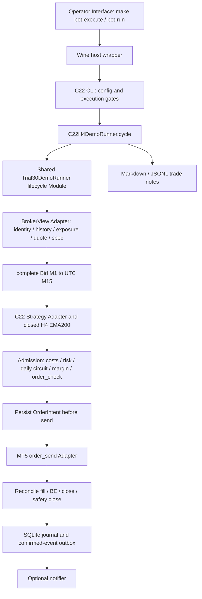

# C22 runtime failure matrix — 2026-10-16

**Verdict: NO-GO สำหรับเงินจริง — พบ6ประเด็นหลักและ1ประเด็น logging ระดับรอง จาก18 RED witnesses ไม่ใช่18 vulnerabilities อิสระ.**

ตรวจ local HEAD `be2d90fd3cb12ae345d24c260df16d4033494327`. Campaign เริ่ม15ต.ค. และจบ16ต.ค. เวลาไทย จึงเก็บ artifacts ใน `runs/c22-case-audit-2026-10-15/`. งานนี้เป็น diagnosis ตามคำขอ ไม่ใช่ remediation หรืออนุมัติ rollout. Runtime/config/risk/baseline contract ไม่เปลี่ยน; ไม่มีการเปิด terminal, initialize broker จริง, ส่ง order จริง, restart watcher, renew cost policy, merge หรือ deploy.

## ขอบเขตและผลที่ตรวจจริง

- **112 deterministic fault/control cases /20กลุ่ม:**94 PASS,18 RED/GAP,0 harness errors. ทั้งผลลัพธ์ repeat ตรงกันทุก byte; รอบเต็มประมาณ10.5วินาที.
- **Existing full suite:**962 tests /77.760s /OK, skipped2. ภายในมี92 named Demo tests. การผ่าน suite เดิมไม่ครอบคลุม invariants ใหม่ที่ไป RED.
- **Native host checks:**2 Python tests PASS รวม shared-MQL5-core cases และ C22 differential. ไม่ใช่การรัน native MT5 Tester.
- Full matrix command intentionally **exit1** เพราะ bugs/gaps ยังอยู่ ไม่ได้เปลี่ยน assertions ให้ผ่านตามพฤติกรรมที่ผิด.
- รายละเอียดทุกcase: [Markdown matrix](../../runs/c22-case-audit-2026-10-15/case-matrix.md), [CSV](../../runs/c22-case-audit-2026-10-15/case-matrix.csv), [structured evidence](../../runs/c22-case-audit-2026-10-15/matrix-final.json). ช่อง evidence มีผล cycle, send count, active state, confirmed events และข้อมูล control ที่เกี่ยวข้อง.

คำว่า“ทั้งหมด”ในรายงานหมายถึง catalog ที่แจกแจงและตรวจด้านล่าง ไม่ใช่การพิสูจน์ว่าไม่มีเหตุการณ์อื่นในทุกbroker/OS/future input. สิ่งที่ใช้เครื่องจำลองพิสูจน์ไม่ได้แยกไว้ใน NOT_RUN catalog ช่วงท้าย.

## Zoom-out: Module map และ callers



- Operator callers: [Makefile](../../Makefile#L99) → [host wrapper](../../scripts/ops/run_c22h4_wine.py#L7) → [C22 CLI](../../scripts/ops/mt5_wine_c22h4.py#L10) → [shared CLI](../../scripts/ops/mt5_wine_trial30.py#L22).
- Strategy Interface: `frame/levels/protects/diagnostics` และ daily/risk parameters ใน [C22H4Strategy](../../scripts/c22h4/runner.py#L56). C22 กับ Trial30 เป็น Strategy Adapters ที่มีอยู่จริง ใช้ deep Module `cycle(now aware UTC)` ร่วมกัน.
- Financial persistence และ irreversible calls อยู่ใน [shared runner](../../scripts/trial30/runner.py#L85), [BrokerView](../../scripts/trial30/broker.py#L17), [Journal](../../scripts/trial30/journal.py#L10). Optional trade-note side effect อยู่ใน C22 subclass จึงข้าม failure-handling seam ของ shared cycle.
- `CONTEXT.md` และ ADRs มีคำศัพท์ SMC/news/rollover/scale-out ที่เป็นคนละ contract. Actual C22ไม่ได้ใช้ Pure B1 daily40%, SMC1.5% sizing, news blackout หรือ forced rollover-flat จากการเปลี่ยน legacy YAML. ห้ามเอากฎเหล่านั้นมาANDรวมอัตโนมัติ.
- `scripts/core/` / Unified Core Environment ใน `CONTEXT.md:76` ยังไม่ใช่ implementation ที่ traceพบ. ไม่สร้าง Module ใหม่เพื่อทำให้เอกสารที่คลาดเคลื่อนดูจริง.
- `main.py`, `smc_main.py`, webhook, B1 EA และ native research EA มีคนละ interface/contract. Full regression suiteยังครอบคลุม legacy tests แต่รายงานนี้ไม่ใช่ independent recertification ของทุกlegacy sender. Native research EA มี Tester-only gate; research winnerยังไม่เป็น sender contract.

## Feedback loop และ hypothesis ledger

เริ่มด้วย command ที่ red-capable และได้รันจริง:

```bash
.venv/bin/python runs/c22-case-audit-2026-10-15/red_loop.py
```

ผล:3casesในประมาณ2.3วินาที; valid-fill control PASS, widened-stop FAIL, optional-note PermissionError ERROR. ใช้ actual public cycle และ existing synthetic broker fixtures ไม่มี real MT5. Loop จำกัด case ได้ด้วย unittest test name.

Hypotheses ก่อนขยาย probes: H1หลังFILLEDข้าม contract checks; H2optional I/Oอยู่นอก protected lifecycle; H3identity/snapshot/historyข้าม API reads อาจไม่สอดคล้อง; H4เวลาหรือquoteเปลี่ยนระหว่างcheck–send; H5restart/ownership/baseline stateค้างข้ามรอบ. หลายสมมติฐานถูกหักล้างบางส่วน: timeout/late fill, delayedBE, transaction error recovery, deadline/quote refresh และ restart ไม่ส่งentryซ้ำใน casesที่ตรวจ. ผลเหล่านี้ไม่ถูกรวมเป็น bug.

ก่อนจัดfinding แก้false-positive assertions3รูปแบบในharness: minimum lotยังอยู่บน min-plus-step grid, dropped incomplete barอาจตอบWAITแทนBLOCKEDอย่างปลอดภัย, และ base broker fixtureไม่ได้จำลอง close execution จึงตรวจ containment requestแทนบังคับให้ตอบCLOSED. Attempt artifactsเก็บไว้ แต่ผลfinalใช้เฉพาะ assertionsที่reviewแล้ว.

## F1 / P1 — Account identity มี check-to-send race

**Cases:** `identity/account_switch_after_final_read`, `identity/c22_account_switch_after_final_read` —2 RED.

Trace: [final identity check](../../scripts/trial30/runner.py#L238) → quote/capital/exposure reads → persist → [order_send](../../scripts/trial30/runner.py#L275). หลังfinal identity readไม่มี account-bound transactionกับการส่งจริง.

Probeเปลี่ยนเฉพาะ synthetic current account ระหว่าง exposure read สุดท้าย. Pdbก่อนsendเห็น `fresh_account.trade_mode=0/login123` แต่ `account_info().trade_mode=2/login456`; mockได้รับsendแล้ว. Shared lifecycleและC22ให้ผลแบบเดียวกัน. Negative controlสลับระหว่างorder_checkกับfinal identity readถูกบล็อกและไม่send.

**ผลกระทบ:** คำว่า“ตรวจDemoก่อนทุกmutation”ไม่ได้พิสูจน์ว่าaccountที่dispatchเป็นaccountเดียวกันตลอดหลายAPI calls. นี่เป็นconfirmed code-level race **ไม่ใช่หลักฐานว่า terminal/brokerจริงยอมfillข้ามบัญชี**; actual account-switch/API/algo-disable semantics ยังไม่ได้ทดลอง.

**แนวแก้:** dedicated terminal/process/account, exclusive operational control และ release/account bindingก่อนเงินจริง. ตรวจidentityให้ใกล้dispatchที่สุดเพื่อลดwindow แต่ไม่อ้างว่าเพิ่มcheckอีกครั้งทำให้หลายAPI callsเป็นatomic. ต้องตรวจbehaviorจริงโดยไม่ส่งเงินจริงและอนุมัติ containment policy ก่อนactivation.

Evidence: [account-race matrix](../../runs/c22-case-audit-2026-10-15/account-race.json), [pdb trace](../../runs/c22-case-audit-2026-10-15/pdb-identity-account_switch_after_final_read.log).

## F2 / P1 — Post-fill contract checks ไม่ต่อเนื่อง

**Cases:** `post_fill/widened_stop`, `changed_target`, `nan_stop`, `nan_target`, `changed_fill_price` —5 RED.

Common checksยังป้องกันmissingSL/TP, wrongvolume และwrongside แต่ [full stop/target/fill-risk checks](../../scripts/trial30/runner.py#L388) ทำเฉพาะเมื่อstatusไม่ใช่FILLED. หลังFILLED ค่าSL/TPที่ยังเป็นค่าบวกหรือNaNสามารถผ่านไปMANAGINGได้. จำลองขยายSLให้ราคาเสี่ยงUSD100บนทุนUSD200แทนbudgetUSD20แล้วไม่halt; ก่อนหน้านี้ยืนยันทั้งBUY C22และSELL shared cycle. การเปลี่ยนprice basisหลังfillก็ไม่ได้reconcileใหม่.

Controls: missing stop/targetเริ่มowned-ticket containmentและตั้งsafety_halt; fresh stopที่tightกว่าBEไม่ถูกwiden; unknownNaNvolumeไม่ถึงsendเพราะstrict persistenceปฏิเสธค่าnonfinite. ไม่สรุปว่าทุกinvalid field bypassได้.

**แนวแก้:** validatefinite/geometry/allowed transitionsทุกครั้งที่reconcileowned position, แยกinitial risk budgetจากfloating-equity policyให้ชัด, ยอมรับapproved BE tightening, และตรวจunexplained price/spec changesผ่านledger. อย่าauto-closeเพียงเพราะticketหรือservice-adjusted basisเปลี่ยนโดยยังไม่ตรวจbroker semantics. การเลือกhalt/alert/closeต้องคงfrozencontractหรือขอownerตัดสินใจก่อนขยายpolicy.

## F3 / P1 — Comment collision ทำให้ active lifecycle ไปจับอีกposition

**Cases:** `post_fill/changed_position_identifier`, `ownership/same_comment_replacement_position` —2 RED.

Reconciliationกรองsymbol/magic/commentที่ [matching branch](../../scripts/trial30/runner.py#L331) แต่ไม่ได้ยืนยันpersisted position identifierเมื่อFILLEDแล้ว.

Witnessที่มีลำดับbroker stateครบ: เปิดposition777 → มีposition888อีกตัวที่magic/commentเดียวกัน → multiple-position guardบล็อกถูกต้อง →777ปิดพร้อมcomplete ledger → เหลือ888 → cycleกลับMANAGING888 ทั้งที่activeยังposition_id777และยังไม่มีCLOSED eventของ777. จึงไม่ใช่แค่การแก้identifier fieldแบบเป็นไปไม่ได้ในpositionเดิม.

**ผลกระทบ:** ปนPnL/close lifecycle หรือสั่งBEบนคนละpositionกับintentเดิมได้เมื่อcommentcollisionเกิด เช่นsenderนอกlocal guard. ไม่ใช่หลักฐานว่ามีduplicateเงินจริงเกิดขึ้นแล้ว.

**แนวแก้:** known active positionต้องresolveด้วยstable POSITION_IDENTIFIER, reconcileclosedoldIDก่อนพิจารณาpositionอื่น, ห้ามadopt/closeposition888โดยอาศัยcommentอย่างเดียว. Fresh POSITION_TICKETใช้routingหลังยืนยันID. Controlเปลี่ยนticket999แต่ID777คงเดิมยังต้องmanageได้: [MetaQuotes](https://www.mql5.com/en/docs/constants/tradingconstants/positionproperties) ระบุว่าticketเปลี่ยนได้จากservice operation แต่identifierคงอยู่ตลอดlifecycle.

Evidence: [pdb identity witness](../../runs/c22-case-audit-2026-10-15/pdb-ownership-replacement.log).

## F4 / P2 — Invalid M1 ถูกaggregateจนดูเป็นvalid M15

**Cases:** `data/nan_minute_high`, `data/invalid_minute_ohlc`, `data/c22_nan_minute_hidden_by_aggregation` —3 RED.

[M1 conversion](../../scripts/pure_b1/broker_data.py#L38) ตรวจUTC/alignment/ordering แต่ไม่ได้validateทุกclosedM1 OHLC. [M15 aggregation](../../scripts/pure_b1/broker_data.py#L95) ใช้15close counts; pandas max/minข้ามNaN. Pdbเห็นM1 highNaN1แถว, close count15, aggregatehigh97.5 และสุดท้ายFILLED. high<lowในหนึ่งminuteถูกmaskด้วยแถวอื่นได้เช่นกัน. ทำซ้ำในC22 public cycleได้.

**ขอบเขต:** เป็นmalformed-feed witness ไม่ใช่หลักฐานว่าsavedbrokerfeedมีNaNจริง. Duplicate, unordered, misaligned, missingminutesและformingbarcontrolsทำงานตามที่ตรวจ.

**แนวแก้:** validatefinite/positiveและOHLC orderingทุกclosedM1ก่อนaggregation. ห้ามไปแก้hash-pinnedhistorical sourcesเงียบๆ; ตรวจผ่านMarket Data Adapterที่ชัดและเก็บfrozen parityไว้. อย่าให้formingbarที่ไม่ได้ใช้ปะปนกับclosed-inputvalidation.

Evidence: [pdb aggregate witness](../../runs/c22-case-audit-2026-10-15/pdb-data-nan_minute_high.log).

## F5 / P2 — NaN free margin ไม่failclosed

**Case:** `identity/nan_free_margin` —1 RED.

Identityตรวจfinitebalance/equity แต่ไม่ตรวจfree margin. ที่ [margin admission](../../scripts/trial30/runner.py#L203), margin5.0 > NaNเป็นFalse จึงผ่านจนmockFILLED. Controls free margin0, unknownmargin/profit และinvalidcapitalปฏิเสธถูกต้อง.

**ขอบเขต:** independent order_checkยังต้องอนุมัติ; ไม่ได้พิสูจน์ว่าbrokerจริงจะยอมให้marginไม่พอ. Defectคือlocalunknown-metadataadmissionไม่failclosed.

**แนวแก้:** validateaccount.margin_freeเป็นfinite/nonnegativeก่อนใช้comparison และประเมินfreshaccountfieldsที่เปลี่ยนก่อนdispatch. ห้ามใช้fallbackunlimitedหรือzeroที่ปิดบังunknown.

Evidence: [pdb NaN comparison](../../runs/c22-case-audit-2026-10-15/pdb-identity-nan_free_margin.log).

## F6 / P1 — Optional note I/Oหยุดwatcherและไม่มีdurable retry

**Cases:** `notes/fill_note_permission_failure`, `notes/blocked_note_permission_failure`, `notes/exit_note_failure_no_recovery`, `cli/watcher_note_error_stops_management` —4 RED.

[C22 cycle](../../scripts/c22h4/runner.py#L163) เรียกnoteหลังsharedcycleและอยู่นอกexceptionhandling. Full CLI witnessตั้งwatch2cycles: validcontrolจบexit0/order1; notePermissionErrorหลังfillทำCLIexit1/shutdown1/openmockposition1 จึงยังไม่ถึงcycleที่สอง. SL/TPยังอยู่ที่broker; ไม่ได้ลบprotection แต่watcherBE/reconcileหยุด.

กรณีclose: financial CLOSEDและeventcommitแล้ว แต่exitnoteล้ม; nextcycleเป็นduplicatebar/WAIT จึงไม่กลับไปเขียนexitnote. การcatchแล้วข้ามอย่างเดียวไม่ทำให้papertrailrecover. `append_note` เขียนMDแล้วJSONLแยกกัน; partialdualwriteมีความเสี่ยงเดียวกัน.

Controlnotifiercallbackerrorถูกแยกไว้และไม่resubmitorder. Callbackที่deliverแล้วค่อยerrorเกิดat-least-onceretryได้โดยไม่เกิดorderซ้ำ; consumerต้องidempotent ไม่อ้างexactly-once network delivery.

**แนวแก้:** confirmedjournal-eventconsumerที่มีidempotencyและvisible pending retry สำหรับnotes/notifications. แยกoptional presentation failureจากfinancial journal failure; ห้ามswallowintent/ledger persistence errorให้ดูเหมือนพร้อมเทรด.

## F7 / P3 — Block note dedupeไม่ตรง“once per day”

**Case:** `notes/blocked_reason_oscillation_dedup` —1 RED.

[trade_block_note](../../scripts/c22h4/runner.py#L169) จำเพียงlast day/reason key. A→B→AในUTCdayเดียวกันเขียนAสองครั้ง ทั้งที่runbookระบุonce/day. ไม่มีorderเกิดขึ้นในprobeนี้.

**แนวแก้:** boundedper-dayreasonset/uniquekey หรือแก้contractเอกสารให้ตรงconsecutivededupeที่ต้องการ. ประเด็นนี้เป็นlogquality ไม่ใช่เหตุให้riskcapถูกข้าม.

## Guardrailsที่มีหลักฐานผ่าน

ในcatalogที่ตรวจ: real/nonUSD/nettingผิดidentity, permission, invalidbalance/equity/spec/quote, expired/wrongcostpolicy, missingexposure/history/countmismatch/deposit, insufficient margin, rejected order_check, late/changedquoteไม่สร้างentryใหม่. Fixed0.01คงเดิมเมื่อcapitalเปลี่ยน;USD30ถูกriskveto,USD32/2000ยังส่ง0.01.

Send10008/10009/10010/10012/10031ที่ยังไม่มีpositionevidenceไม่ถูกประกาศFILLEDและไม่blindretry. Laterfillresolveoriginalintentได้. ValidBE, late BE confirmation, tighterstop, BErestart, closing magic 0, fees/swap/full cash, missingclosingledger, failedfinancial commitsและUNKNOWNrestartไม่เกิดentryซ้ำในcasesที่ตรวจ. Staleentrycostpolicyไม่หยุดexistingBE. Sameaccount/separate journalในlocal guardเดียวกันเปิดwriterที่สองไม่ได้.

Existing92Demo testsเพิ่มcontrolsเรื่องpartial safetyclose, restart/legacyambiguousclose, pending order/incomplete ledger, residual growth, foreign position และlate cash attribution. รายชื่อexacttestอยู่ที่ [existing-demo-tests.json](../../runs/c22-case-audit-2026-10-15/existing-demo-tests.json). PASSของUNKNOWNแปลว่าfailclosedอย่างอนุรักษ์นิยม ไม่ได้แปลว่าrecoverได้เองโดยไม่ต้องมีbroker/operator evidence.

## สิ่งที่ยังต้องพิสูจน์นอก112cases — NOT_RUN

1. Actual terminal account-switch/session binding/algo-disable behavior: mockraceไม่ใช่live acceptance proof.
2. Processkill/powerloss/fsync/diskfailureจริง รวมfilesystemlockingและjournalrestoreจากbackupเก่ากว่าbrokerstate.
3. สองเครื่องหรือclonedworkspaceบนaccountเดียว: localSQLiteguardไม่ใช่distributedaccountfence.
4. BrokerจริงFOK/IOCpartialfill, delayeddeal/history, timeoutและsafetycloseresidual; mocksไม่ได้รับรองserver-specific semantics.
5. Brokerreticket/swapreopenและprice basis adjustmentจริง พร้อมstableID/ledgerchain.
6. Actualcommission/fee/posting/centrounding/standalone cash deals และการนับdailylossเทียบstatementจริง.
7. Swaprate/calendar/DST/triple/holiday/entitlementของบัญชีเงินจริง; frozenresearchUTCmidnightยังCOST_INCONCLUSIVE.
8. Realrequest→filllatencyและentry/SL/TPslippage; cashcommissionstressไม่เปลี่ยนpricepath.
9. Wide spread, gaps, marketclosure/weekendและHMRที่มีผลต่อmargin/stopfills — ต้องcostscenarioรวมswapทุกview.
10. Macsleep, VPN/networkdrop, terminalrestart, watchdogและreconnectที่มีpositionค้าง.
11. Cachebootstrap/restart/parityบนbrokerhistoryครบและshadowgateที่ไม่เกิดdivergence;96barsข้ามmidnightเป็นplumbingไม่ใช่กำไร.
12. Prospective/untouchedvalidationของwinner81a78454baaffcd1หลังตรึงกฎ. Reuseddiscoveryและrepeatsไม่ใช่holdout.
13. TunedStrategyAdapterจริง: BUYBE/daily2/SELL48/RSI7/30ยังไม่ใช่current Demo. Native Tester harness/economic runtimeยังNOT_RUN.
14. Runningprocessloadedcodehash/releasemanifestและdependencyversionsเทียบapprovedbuild;localsourcepassไม่พิสูจน์deployment.
15. Humanoperatorcommandpolicy: `bot-run` สามารถexecuteเมื่อinheritedgate=1ตามrunbook แม้README/helpบางส่วนยังบอกshadow. ต้องทำinterfaceให้ไม่กำกวม.
16. Notificationsจริง: CLIไม่ได้enableTelegramnotifier;durable outboxไม่เท่ากับผู้ดูแลได้รับalertแล้ว.
17. Multi-midnightbaselinecontinuity: process-scopedpolicyที่ownerเลือกคงไว้ยังblockได้;ห้ามreset/restartเพื่อเพิ่มallowanceโดยไม่เปลี่ยนcontract.
18. LegacySMC/news/rollover/B1/webhooksenderทุกpathไม่ได้ถูกประกาศreal-readyจากC22auditนี้. Oneaccount/onesenderต้องครอบคลุมoperationalentrypointsทั้งหมด.

รายละเอียดprofileและeconomicaccountingaudit58cells/16repeatsอยู่ใน [readiness recheck](2026-10-15-real-money-readiness-recheck.md);งานนี้ไม่ได้รันeconomicbacktestใหม่.

## Reproduceและข้อสรุปงาน

```bash
# Expected exit1: desired invariant gaps remain; no real MT5 calls.
.venv/bin/python runs/c22-case-audit-2026-10-15/matrix.py
.venv/bin/python runs/c22-case-audit-2026-10-15/matrix.py --select ownership/
.venv/bin/python runs/c22-case-audit-2026-10-15/matrix.py --select account_switch

# Existing regression suite, observed exit0.
.venv/bin/python -m unittest discover -s tests
make native-frequency-check
```

Artifacts: [final case evidence](../../runs/c22-case-audit-2026-10-15/matrix-final.json), [exact repeat](../../runs/c22-case-audit-2026-10-15/matrix-repeat.json), [full suite](../../runs/c22-case-audit-2026-10-15/full-suite.log), [source provenance](../../runs/c22-case-audit-2026-10-15/source-manifest.json). Source snapshotเป็นเฉพาะ16traced source/fixture/config files ไม่ใช่transitive dependency lockทั้งหมด. Artifactsในrunsถูกgitignoreตามpolicy;ไม่ใช่committedreleasepackage.

Diagnosis phases1–4เสร็จ: REDloop, controls/minimization, rankedhypotheses, pdbinspectionและrepeatledger. Phases5–6เรื่องproduction fix/regression greenยังไม่ทำ เพราะคำขอรอบนี้คือค้นหาและบัญชีจริง/containment response/allowed post-fill transitionsต้องตกลงก่อนแก้material behavior. Debuggerไม่แก้production code;ไม่มีtemporary instrumentationในruntimeให้ลบ. Reproducersเก็บในcampaign debug directoryและยังREDตามจริง ไม่อ้างว่าปัญหาถูกแก้.

ลำดับremediation: F1terminal/account isolationและF3ownershipก่อน → F2allowed state validationและF6durable note failure isolation → F4raw feed/F5finite account guards → F7dedupe/documentation. หลังfixต้องให้112casesที่เป็นapproved invariantsผ่าน แล้วทำselected strategy parity/forwardและactual broker evidenceก่อนพิจารณาเงินจริง.
