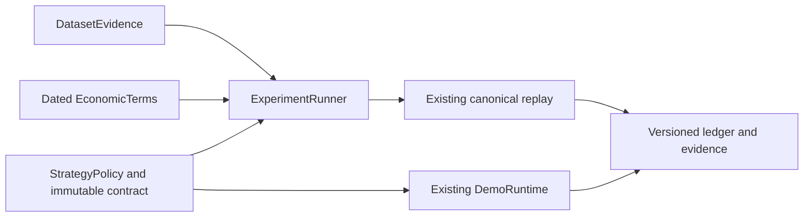

# C22 terminal-growth investigation — 2026-10-24

**ปรับ research และรันแล้ว: 74 configurations, 234 economic cells, 24 fresh repeats.**
ตามเกณฑ์เจ้าของ ใช้บัญชีเดียวตั้งแต่ต้นถึงล่าสุด วัดกำไรสุทธิปลายทางสูงสุดและ
modeled survival. DD/ยอดเงินต่ำสุด/จำนวนไม้ต่อเดือนไม่ใช่เกณฑ์คัดทิ้ง.
ตัวทำกำไรสูงสุดภายใต้ base model เปลี่ยนทุน **$200 → $1,697.58**;
price-stress **$1,263.10**. ตัวที่กำไรขั้นต่ำระหว่าง cost/guard scenarios สูงสุด
จบ base **$1,553.09**, price-stress **$1,303.63**. Active C22 เดิม $407.17/$394.02.
ผลทั้งหมดเป็นย้อนหลัง **COST_INCONCLUSIVE**, ไม่ใช่ผลบัญชีจริงหรือกำไรรับประกัน.

## ขอบเขตและเกณฑ์ใหม่

ข้อมูลเดียวกันทุกตัว: **171,171,013 Exness XAUUSDm Bid/Ask ticks**, 49,729 complete
Bid M15 bars, actual2024-09-01T22:05:06.129Z→2026-10-23T20:57:59.517Z.
Requested `[2024-09-01,2026-10-24)` UTC; latest available quote23ต.ค.
เริ่ม$200ครั้งเดียว, fixed0.01, singleposition, cost-inclusive initial cap10%,
daily loss10%, no recovery, ไม่มีเติมทุน/resetรายเดือน/ลบเดือนขาดทุน.
Accountต้องยังsolventและnetpositiveในnamed cost scenarios. ไม่ใช้minimumbalance
หรือDD thresholdจัดอันดับ. ตรวจ equity เพื่อ survival แยกจาก balanceปลายทาง.

ใช้ frozen canonical detector/entry/replay เดิมผ่าน existing research adapter;
ไม่สร้าง execution engine ใหม่. ต้นทุนทุกcellรวมswap:

- Base: recorded Bid/Ask, modeledcommission0, slippage0.
- Price stress: recorded spread+$0.20/oz และadverse slippage$0.10/ozต่อmarketfill.
- Fee sensitivity: price stressข้างต้น +commissionสมมติ$7/lot/roundtrip.
- Point-mode swap: long−567.4/short0, point0.001,100oz/lot,Wednesdaytriple,
  UTC-midnightของpreceding business day. Missing/unsupported metadataต้องหยุด.

Broker historical tariff/entitlement/calendar และtarget-serverfillsยังไม่verified.
Quotesจริงตรวจต้นทางได้ แต่ [Exness public archive](https://www.exness.com/tick-history/)
เป็นindicative. [MetaQuotes](https://www.metatrader5.com/en/terminal/help/algotrading/testing_features)
แยกordertriggerกับexecution price; canonical modelนี้ยังไม่ใช่nativeTesterหรือ
broker-paritytest. ไม่อ้างว่าMODELED_SURVIVALเท่ากับพิสูจน์broker stop-outจริง.

## วิเคราะห์และปรับอะไรจริง

Stage1ตรึง50configsก่อนเห็นผล: activeC22, prior tuned, prior profitable-exits,
one-factor changesของRSI/threshold/SELLlookback/TP/BUYstop/BUYBE/dailycounter/cooldown
และ3causal SELLfilters. Filtersใช้closedH4EMAslope,breakoutdepth/ATR,
หรือATRเทียบtrailing96-barmedian; ไม่มีdate-specific ruleหรือfuturelabel.

ตัวกรองใหม่ไม่ได้ชนะทุกกรณี. Stage1ตัวนำคือpriorprofitableexitsที่เปลี่ยน
**BUY SL1.5→2ATR**: base/stressnet **+$1,497.58/+$1,063.10**.
คู่เทียบpriorprofitableexitsเดิมบนข้อมูลและต้นทุนชุดเดียวกัน net
+$1,278.41/+$617.83. Base BUY contributionเพิ่ม$350.57→$590.87;
SELL contribution$927.85→$906.71. นี่คือattributionตามdirectionบนบัญชีต่างpath,
ไม่ใช่causal decompositionที่แยกผลBUYออกจากequity/admissionอย่างอิสระ.

Traceกลไกจริง: `prepare_entry` เลือกBUYstopATRจากconfig แล้วคำนวณTP2Rจาก
roundedstopdistance. SL2ATRจึงเปลี่ยนทั้งrisk/target/holding/admission ไม่ใช่
ขยายstopฟรีโดยคงriskเดิม. ตัวอย่างfirstdivergence BUY2024-10-29T04:15Z:
เดิมrisk$4.886/close−$4.89; SL2risk$6.514/close−$6.538. ไม้แรกแย่ลงจริง;
กำไรรวมที่ดีขึ้นต้องวัดจากบัญชีทั้งหมด ไม่ใช่เลือกโชว์เฉพาะsavedloss.
Entrycap10%และfixedlotยังตรวจทุกไม้.

Stage2ตรึง24neighborsของสองStage1leadersก่อนรัน. พบcaseเดียวกันแต่
**max_daily_losses2→1** ทำให้worst base/price-stress terminalnetดีขึ้น:
base+$1,353.09/stress+$1,103.63. ตรวจraw/centdaily-losscounterและrepeatfinalists
ก่อนสรุป. ไม่มีการแก้tradeย้อนหลังเมื่อรู้ผลแล้ว.

## ผลบัญชีต่อเนื่อง — raw loss counter

| Case | Base final / net USD | Price-stress final / net USD | Fee-stress final / net USD |
| --- | ---: | ---: | ---: |
| Active C22 control | 407.17 / +207.17 | 394.02 / +194.02 | 402.93 / +202.93 |
| Maximum base profit: daily2 | **1697.58 / +1497.58** | 1263.10 / +1063.10 | 1315.22 / +1115.22 |
| Maximum worst-cost profit: daily1 | 1553.09 / +1353.09 | **1303.63 / +1103.63** | 1320.49 / +1120.49 |

Base returnต่อทุนเริ่ม: control+103.58%,maximum-base+748.79%,worst-cost+676.55%.
Maximum-base519trades,WR39.69%,PF1.342;worst-cost414trades,WR40.82%,PF1.398.
Winrateต่ำกว่าcontrol47.69%แต่netสูงกว่า: endpointnetเป็นเป้าหมาย ไม่ใช่winrate.
แต่ละcostviewadmitคนละtradesได้;feeviewที่netสูงกว่าprice-stressไม่แปลว่าfeeเพิ่มกำไร.

ทั้งสองresearchleadersไม่มีbankruptcyในmodel,ยังมีtradesถึง23ต.ค.,ไม่มีforced
END_OF_SAMPLEclose. ไม่ได้ทำเงินโดยเพิ่มlot,เอาriskcapออกหรือเปิดrecovery.
Maximum-base rawDD34.80%/35.71%/36.52%;worst-costrawDD36.60%/37.48%/38.16%.
Worst reviewed minimumequity154.24USD/135.90USDตามลำดับ;เปิดเผยเป็นdiagnostics
ตามเกณฑ์ใหม่ ไม่ใช้ปัดตก. Max reviewed entryriskอยู่ภายใน10%ทุกscenario.
Observed adverse-equity margin proxyของleadersต่ำกว่า2%ทุกreviewedscenario;
proxyไม่ใช่historicalbrokerstopoutparity.

## Parameters และผลของdaily counter

ทั้งสองใช้ RSI7cross30/BUYEMA50,SELL48/EMA50,closedH4EMA200,
BUYSL2ATR/TP2R/BE1R,SELLSL2.5ATR/TP1.35R/BE1R. Daily10%,staticcap10%,fixed0.01,
cooldown0,all sessions. Contextfilteroff: ไม่เพิ่มfilterที่ผลไม่ชนะเข้าตัวเลือกสุดท้าย.
แตกต่างกันเพียงdaily losing-exitcount: maximum-base2;worst-cost1.

| Case | Cent-counter base final USD | Cent-counter price-stress final USD | Cent-counter fee-stress final USD |
| --- | ---: | ---: | ---: |
| Maximum base profit | 1697.58 | 1291.24 | 1315.22 |
| Maximum worst-cost profit | 1555.23 | 1310.96 | 1316.09 |

Guard sensitivityเปลี่ยนเพียงpredicateนับlossจาก`net<0`เป็นUSDcentROUND_HALF_UP<0
ในprivatecopyของcanonicalfunction. ไม่roundราคา,cash,commissionหรือswap;
ไม่แก้functionglobals/frozensource. Counterมีผลกับentryถัดไปและequitypath.
ทั้งสองบวกครบ6cost/guardscenarios. Worst6net: **+$1,063.10** สำหรับbaseleader,
**+$1,103.63** สำหรับworst-costleader. Finalreviewเลือกdaily1ตามpredeclared
maximum-worst-netranking;เก็บdaily2แยกให้ตรงความต้องการmaximum-baseprofit.
ไม่มีการอ้างว่าchoiceหนึ่งดีที่สุดภายใต้ทุกpossiblecostassumption.

Reviewable research configs:

- Maximum baseprofit,experimentcase`646690b541405adf`:
  [config9e511d195c52ef3d](../../config/research-c22-terminal-profit-9e511d195c52ef3d.json).
- Maximum worst-costprofit,experimentcase`06392009f347ec4a`:
  [config63062bbbb767a576](../../config/research-c22-terminal-robust-63062bbbb767a576.json).

CaseIDhashesconfig+context;adapterconfigIDhashesvalidatedbareconfig. Mapping/SHA256:
[research-config-handoff.json](../../runs/c22-terminal-growth-2026-10-24/research-config-handoff.json).
These are researchconfigs; frozenDemo detectorrejectsdifferentcontract/sourcepins.
No runtime/sourcepin/broker/login/order/restart/deploy/cutover change performed.
CORE_STRATEGY6.46recordsresearchobjective/rules/results;6.33activeDemounchanged.

## Verification, artifacts และขอบเขตข้อสรุป

Completed **74 distinct configs**:50Stage1+24Stage2. **234economiccells**:
222raw-countercases plus12centguardcells;**24freshwhole-resultrepeats** forfour
reviewedfinalists/control. These use overlappinghistory,not234independentsamples.
Controlmatchesoriginalfullresultsครบ3viewsทุกfield. Bothnewcontextchecksและ
finalistsผ่านprefixcausalityที่2025-01-01,2026-01-01,2026-10-07.
TestsalsoverifyBUYsignalpreservation/noinventedsignals,cent−0.004/−0.005boundary,
rankingignoresDD/minimumbalancebutretainspositive-net/solvency.

Independentverifierผ่าน234cells/24repeats: gross/net/signedswap/calendar,
entryequity/fixedlot/initialrisk,nonoverlap,daily-lossadmissioncounter,
PF/DDwitness/minimumequity,input/source/completionhashes. Existing33focused
regressionsจากprecedingimmutableengineauditยังเป็นหลักฐานเดิม;
รอบนี้ไม่อ้างว่ารันfullsuiteหรือbrokerconnectivityใหม่.

```bash
# Completed campaign is immutable; rerun verifies completion/source/input identity.
PYTHONPATH=. .venv/bin/python runs/c22-terminal-growth-2026-10-24/campaign.py

# Recompute saved-result accounting, daily guard and manifest hashes independently.
PYTHONPATH=. .venv/bin/python runs/c22-terminal-growth-2026-10-24/verify.py
```

Campaigncheckpointสามารถresumeก่อนCOMPLETEโดยตรวจprotocol/source/input/cellhash;
source/config/inputเปลี่ยนแล้วต้องfreshcampaign ไม่overwriteevidence.
Logs,allcases/failedcases,source snapshots,raw/centrepeats,reviewtradeCSVsและ
selectedresearchอยู่ใต้ignored[runs directory](../../runs/c22-terminal-growth-2026-10-24/).
หลักฐาน: [protocol](../../runs/c22-terminal-growth-2026-10-24/protocol.json),
[Stage1 diagnosis](../../runs/c22-terminal-growth-2026-10-24/stage1-diagnosis.json),
[results](../../runs/c22-terminal-growth-2026-10-24/results.json),
[independent verification](../../runs/c22-terminal-growth-2026-10-24/independent-verification.json).

**Scrutiny verdict: retain both measured research leaders for review.**
Goalปลายทางกำไรทำได้ดีกว่าincumbentในnamedmodelโดยไม่เพิ่มlot/ถอดcap.
Simplerexistingadapterชนะการสร้างengineใหม่;filtersใหม่ไม่ถูกใส่ถ้าไม่เพิ่มผล.
แต่การเลือกparametersใช้historyทั้งชุด: adaptive retrospective discovery,
ไม่ใช่walk-forwardself-retuningbotหรือunusedholdout. Per-tradefeaturescausal
ไม่ได้ทำให้selectionเป็นout-of-sample. Bestใน74แบบที่ทดสอบ ไม่ใช่globalmaximum
หรือคำรับรองอนาคต. Costs/targetfeed/fillparityยังเปิดอยู่;actualDemo replacement
ต้องseparatereadinessreviewและexecution-timeownerapprovalตามAGENTS.

## Credibility review: data, real logic, graph and selection bias

Owner asked whether the result is traceable rather than invented, lucky, biased
or unrealistically favorable. **Traceability passes; absence of overfitting and
future profitability are not established.** These are different claims.

Fresh checks: [credibility-audit.json](../../runs/c22-terminal-growth-2026-10-24/credibility-audit.json)
and its [audit code](../../runs/c22-terminal-growth-2026-10-24/credibility_audit.py).
No new economic replay or parameter change was made in this credibility review.

- Parsed the actual displayed Canvas JSON, rather than trusting its builder.
  Recomputed **468 plotted monthly points** across three cases, three cost views
  and two guard modes; all match the saved closing ledgers. All displayed metric
  objects also match their saved cells, and final plotted values reconcile with
  final balances. The chart is **$200 + cumulative net attributed to exit month**,
  not a native MT5 screenshot, price-candle chart or continuous tick-equity curve.
  Its monthly sampling omits intramonth equity excursions visually; exact model
  DD is reported separately. Smooth-looking monthly lines are not proof of low risk.
- Checked **1,063 base-view positions**:130incumbent+414worst-cost+519base-profit.
  Entries match timestamped Bid/Ask in the hash-bound source tape. Recomputed
  signal direction and initial entry/SL/TP/risk from the actual research config
  and shared detector/entry functions. SL/other exits match executable source
  quotes at their timestamps; TP timestamps have an observed trigger and use
  the model's specified target fill. This validates code/data linkage, not a real
  broker fill. Overlapping positions between cases are not independent samples.
- Reran the saved-result independent verifier: **234cells/24repeats PASS**, including
  source/input/completion hashes, cash/swap/risk/daily counters. Repeats test
  deterministic reproducibility and accounting, not statistical independence.
- $1,697.58 is from a **modified research C22**, not the unchanged active Demo.
  Entry/geometry share canonical functions; the complete broker runtime and native
  terminal are not being replayed. The unchanged Demo control remains $407.17
  in the named base model.

**Selection-bias limitation:** the74configuration results were evaluated on the
same full history, andStage2parents were chosen afterStage1outcomes. Prior research
leaders were also previously selected on overlapping history. This is in-sample
adaptive optimization with multiple testing. Per-trade prefix causality does not
turn parameter selection into out-of-sample evidence. Tick count171million and
repeating a profitable run24times cannot quantify or exclude chance selection.
No untouched-holdout result, PBO estimate, multiple-testing-adjusted significance
or actual forward profitability has been established. The mechanism is discussed
in the primary research paper [The Probability of Backtest Overfitting](https://www.davidhbailey.com/dhbpapers/backtest-prob.pdf);
this review has not estimated its probability for C22.

**Realism limitation:** historical swap/tariff/rollover and target-server parity
remain unverified. Base assumes no extra slippage/commission; specified stresses
are sensitivities, not a bound on all news/gap/outage conditions. TP target fills,
stop handling, latency/rejections/partial fills, live safeguards and broker stop-out
may differ. Therefore even a correctly computed historical profit may overstate
what is executable or predictive. Exness itself describes the public feed as
[indicative](https://www.exness.com/tick-history/) and notes
[server differences](https://get.exness.help/hc/en-us/articles/360021547851-Tick-history).

The useful next validation is to freeze these configs and evaluate subsequently
unexposed market data without retuning, with matched target-broker data/cost/fill
reconciliation under the existing Demo approval gates. Chronological validation
on already seen history is an additional diagnostic; it cannot recreate an
untouched holdout. Continuing to maximize the same historical endpoint alone
cannot close the selection-bias limitation.

**Verdict: verified, reproducible historical simulation; unqualified as proof of
an unbiased live edge. Neither fabrication nor luck can be judged solely from a
large terminal profit; the audit establishes the traceable simulation, while luck,
selection effects and execution realism require separate evidence.**

## Risk/MM/DD/RR coverage review — 2026-10-24

**Coverage is partial: mathematical/model checks pass at the stated scope; the
new research configurations are not yet qualified as an executable bot contract
or verified live profit.** The owner's primary criterion remains terminal profit
and survival; this review does not introduce a DD or minimum-capital cutoff.
No parameters or economic results were changed in this review.

Fresh work, using existing frozen real-quote results:

- [MM/RR/tail-risk metrics](../../runs/c22-risk-coverage-2026-10-24/metrics.json):
  18 full-account paths (three cases × three cost views × two counter models).
  Recomputed cash, risk, planned RR, realized payoff/expectancy, losing streaks,
  peak-recovery intervals and daily entry admission. Independently reconstructed
  flat/open-midnight daily baselines and checked **6,366 admitted entries** against
  the daily10% gate. These are overlapping scenarios, not independent samples.
- [Independent observed-tick DD reconstruction](../../runs/c22-risk-coverage-2026-10-24/independent-tick-dd.json):
  six full-account base/price-stress paths. Rebuilt cash/floating equity from all
  source quotes while positions were held, including modeled spread, entry fees,
  swap and final fills; did not rely on monthly graph points or engine DD witnesses.
  Final cash, minimum equity and maximum DD match all six stored results.
- [Focused tests](../../runs/c22-risk-coverage-2026-10-24/focused-tests.log):
  **108 tests /67.408s /OK**, freshly executed. Modules cover CLI, current C22 public
  cycle, containment, safety recovery and replay logic. Fixtures are synthetic
  for code edge cases; their results are not included as economic profit evidence.
  Includes cost-inclusive risk rejection instead of lot clamping, UTC daily10%,
  persisted baseline/restart, unknown send timeout, partial/residual ownership,
  source drift, protection/BE and sizing/replay accounting behavior. This is not
  a claim of exhaustive failure coverage or real broker execution.

| Area | Verified scope | Still unverified / outside scope |
| --- | --- | --- |
| Price provenance | Exness source ZIP/URL/hash; actual Bid/Ask tape | Target-server parity and independently certified full session coverage |
| MM / sizing | One USD200 account, fixed0.01, single position, no recovery; no forced lot-up rounding | Other initial capitals/lots/percentage sizing/compounding were not economically qualified; they are not required by this fixed-lot contract |
| Initial risk | Cost-inclusive price/commission/slippage risk≤10% at admission | Guaranteed realized loss≤10% or≤1R; future swap/gap loss is not bounded by this admission test |
| Daily controls | Daily10% entry gate and1/2 losing-exit gate; raw/cent sensitivity; baseline reconstruction; runtime persistence tests | A hard cap on final daily loss, brokerage restart/failure effects on actual PnL |
| RR | Planned price RR and net realized cash payoff/expectancy recomputed from ledgers | A fixed realized RR or unchanged future payoff distribution |
| DD / recovery | Observed-tick equity DD independently matches; closing-balance recovery and losing streaks measured | Equity between unobserved quotes and performance under unobserved future regimes |
| Gap / stop execution | Historical quote-gap losses are represented and measured | Exhaustive news/liquidity/gap extremes, calibrated actual fill/rejection distribution |
| Margin / stop-out | Static snapshot margin/adverse-equity proxy and entry margin model | Actual historical leverage/HMR/tiering/stop-out/partial liquidation behavior |
| Cost / swap | Every economic case includes declared swap and named cost sensitivities | Attested historical/current account costs, rollover and swap entitlement; COST_INCONCLUSIVE |
| Bot lifecycle | Current frozen C22 runtime passes focused fake-broker integration checks | New research rules wired into a matching strategy adapter and proved end-to-end |
| Statistical validity | Reproducibility, internal accounting, selected causal-prefix checks | Untouched/forward profitability, selection-adjusted significance or quantified risk-of-ruin |

### RR and tail risk: actual measured examples

Maximum-base-profit case, raw base model: **519 trades**, average winning net
**$28.5055**, average losing net **−$13.9762**, cash payoff ratio **2.0396**,
expectancy **+$2.8855/trade**, mean netR **+0.1605R**. Raw price-stress expectancy
**+$2.0444/trade**, payoff **2.0200**, mean netR **+0.1051R**. These are descriptive
in-sample estimates, not independent statistical proof. Planned price RR is about
BUY2R/SELL1.35R after tick-grid rounding; this differs from average-win/average-loss
cash payoff and from each trade's realized netR.

Observed historical tail: BUY opened **2026-04-17T16:00:00.040Z**, closed
**2026-04-19T22:01:34.954Z**. Source tape last Friday quote at20:57:59.596Z had
Bid4832.633; next observed Sunday quote had Bid4774.618/Ask4775.118, a49-hour
observed quote gap. In the price-stress model:

- Modeled entry4868.032, initialSL4823.971, initial risk **$44.161**.
- Modeled exit4774.418 (recorded Bid adjusted for declared spread/slippage).
- Swap−$0.5674; final net **−$94.1814 = −2.1327R**.

This witness comes from the tape and actual simulated ledger, not an invented
stress price. It is still a simulated fill on public quotes, not a broker deal.
**An initial risk cap is not a stop-fill guarantee.** Daily10% is a gate on new
entries after a loss; it does not guarantee that an already open position cannot
lose more during a gap. Freezing risk at1R in accounting would hide this tail.
Maximum-base-profit raw-base longest loss streak9; worst-cost case11.
Completed closing-balance peak-recovery intervals reach about100.40/122.50days,
respectively. This recovery measure is not continuous tick-equity underwater time.

### Concrete integration blocker for the improved research rules

The live strategy class remains frozen:
[C22H4Strategy](../../scripts/c22h4/runner.py#L56) uses max_daily_losses1 and
[protects](../../scripts/c22h4/runner.py#L112) returns true only for SELL.
[BarCache](../../scripts/c22h4/strategy.py#L108) still prepares the old frozen
CONTRACT. The new research leaders require BUYBE1R and changed entry/exit rules;
the maximum-base-profit case additionally requires dailycount2.

Fresh read-only construction confirmed current BUY protection=false/SELL=true,
and current dailycount1 versus researchprofit dailycount2. No broker calls were
made. This is an intentional separation from active Demo, not a bug in its old
contract. The profitable research config cannot simply be loaded and claimed to
have the same live lifecycle. A matching reviewed strategy adapter, full-cycle
BUY/SELL/BE/daily-counter tests and broker/shadow parity remain necessary before
adoption. The current source/contract guard rejects an incompatible replacement.

### Next work that closes evidence gaps

1. Freeze the candidate contracts and evaluation rules; stop selecting new
   parameters from the same validation outcome. Preserve both endpoint-profit
   and conservative-cost choices without silently switching the primary claim.
2. Implement/review the chosen candidate's strategy adapter against its exact
   research rules, keeping the old Demo sender/config intact; verify both BUY and
   SELL through shared admission, persisted intent, protection and closing ledger.
3. Use matched target-broker input/history and supported cost/spec evidence to
   compare decisions, geometry, risk/margin and realized profit/commission/swap/fee.
   Native Tester is one possible independent cross-check, not the only acceptable
   path or a reason to stop otherwise safe offline work.
4. Evaluate subsequently unexposed data without retuning, preserving the continuous
   account and reporting net growth, realized R, tail losses, DD and completeness.
   A controlled Demo trial still follows the existing execution-time approval
   gates. No profitable future outcome is established by this checklist alone.

**Verdict: risk arithmetic and observed-history behavior verified at a bounded
scope; new-contract bot integration, actual broker economics and forward edge
remain open. Repeated historical profit optimization alone cannot finish them.**

## Scrutinize and codebase-design: closure priorities after recheck

Goal: make the data-to-decision-to-ledger path reproducible and compatible with
the intended bot contract before using selected historical profit as adoption
evidence. Smaller alternative: retain `prepare_entry` and the canonical replay,
concentrate duplicated policy/evidence rules at a few existing seams, and stop
adding filters until those seams are verified. No new trading engine is needed.
This is a review and design proposal; strategy, source pins and Demo are unchanged.

### P1 — Research policy and active bot policy still differ

**Evidence:** [active strategy](../../scripts/c22h4/runner.py#L56) fixes dailycount1,
and [protects](../../scripts/c22h4/runner.py#L112) enables SELL protection only.
[BarCache](../../scripts/c22h4/strategy.py#L108) prepares the old CONTRACT; both new
research leaders require different entry/exit rules and BUY BE. The maximum-base
leader also requires dailycount2. The mismatch is intentional isolation, but is
an adoption blocker. A valid research JSON is not a replacement runtime.

**Minimal change:** one immutable StrategyContract consumed by a pure
**StrategyPolicy module** for entry/protection plans and policy values. Keep
`prepare_entry`; extract only genuinely duplicated protection/contract decisions.
Replay and DemoRuntime consume the same policy; execution/reconciliation remain
in their existing implementations. Test the shared interface with identical
completed bars, quotes and positions: direction, initial SL/TP/risk, BUY/SELL BE
activation and daily-loss decisions must agree. Preserve old-contract behavior
and frozen artifacts; introduce new contracts explicitly rather than changing pins
to force an existing adapter to accept them. Shared math still needs independent
broker evidence; shared implementation alone is not an independent oracle.

### P1 — Hash integrity does not establish complete market coverage

**Evidence:** [verify_input](../../scripts/research/c22_frequency_data.py#L22)
checks artifact hashes. [import_month](../../scripts/research/public_exness_archive.py#L64)
checks schema/UTC/order/prices; [bar aggregation](../../scripts/research/data.py#L129)
accepts observed15-M1 groups. None establishes that every expected trading session
was present. The retained [source validation](../../runs/c22-real-data-audit-2026-10-24/input/fresh-source-validation.json)
explicitly says `session_completeness=NOT_CERTIFIED`. A gap can be a scheduled
closure, a feed outage, or unknown; it cannot be classified from endpoint counts.

**Minimal change:** a **DatasetEvidence module** with one validation interface
covering hashes, source identity, UTC chronology, bar completeness, causal-prefix
metadata and gap/session classification against a sourced broker calendar.
Reuse existing readers/aggregation. Exness archive and broker export are two real
inputs to this seam; normalize their evidence without pretending their quotes are
identical. Preserve unknown intervals and `INCONCLUSIVE` status; do not fill bars
or delete losing gap trades. Hash match means same bytes, not full coverage.
Exness also documents [server differences](https://get.exness.help/hc/en-us/articles/360021547851-Tick-history).

### P1 — Historical economic terms still have no dated broker-backed contract

**Evidence:** [SwapPolicy](../../scripts/research/rollover.py#L11) explicitly models
current-spec rates and a UTC-midnight calendar; [margin admission](../../scripts/research/breakout_entry.py#L104)
uses static entry notional/leverage. These are disclosed assumptions across the
whole two-year history, not attested historical rates/HMR/stop-out. Cost-stress
numbers do not replace broker evidence. The live runtime already has a dated
[evidence validator](../../scripts/demo_runtime/costs.py#L51); reuse that concept.

**Minimal change:** pass explicit dated EconomicTerms with currency/units,
commission, swap schedule, symbol/margin terms and evidence status. Keep a named
snapshot adapter for frozen research and a dated-evidence adapter where supported.
Resolve terms at the event timestamp; never substitute zero or label a current
snapshot historical truth. Unsupported history remains COST_INCONCLUSIVE.
Keep initial budget separate from realized loss: observed−2.13R is valid model
output, not something to clamp to−1R to satisfy a risk label. Any weekend/holding
policy experiment must be predeclared and replayed across the full history.

### P1 — Selection and validation remain different experiments

**Evidence:** [campaign protocol](../../runs/c22-terminal-growth-2026-10-24/campaign.py#L152)
sets `holdout=False`; Stage2parents come from Stage1outcomes and the final rank
uses the same history. This is correctly labeled COMPLETE_DISCOVERY, not proof of
unbiased profit. Repartitioning already inspected prices cannot make them unseen.

**Minimal change:** freeze a candidate and a separate validation protocol before
subsequently unexposed observations. Keep data role, decision timestamp, contract,
cost evidence and result status in the experiment interface. Report DISCOVERY,
VALIDATION and FORWARD evidence separately. Do not retune on a validation outcome
then reuse that outcome as validation. The [primary overfitting research](https://www.davidhbailey.com/dhbpapers/backtest-prob.pdf)
explains why repeated selection on the same history requires separate treatment.

### P2 — Selector can emit an ineligible case when every finalist fails

**Evidence:** [final_rank](../../runs/c22-terminal-growth-2026-10-24/campaign.py#L267)
orders eligibility before profit, but then unconditionally uses `ordered[0]` and
exports a selected research config. If all are ineligible, ranking still has a
first case. Reproduced by extracting and executing the exact selector AST with
synthetic ranking inputs: an insolvent positive-PnL case versus a solvent losing
case selected the insolvent case even though neither qualified.
[Reproduction](../../runs/c22-recheck-design-2026-10-24/selector-edge-case.json).
This is a selector edge-case defect, not a new economic result. Actual selected
and maximum-base leaders both pass all6reviewed scenarios, so their published
balances and eligibility are not invalidated by this finding.

**Minimal change:** in the next tracked runner version filter eligible finalists
before selection; empty eligible set returns `NO_QUALIFIER`, `selected=null`,
and no selected-config export. Test the public selection interface for all-loss,
insolvent, missing-scenario and valid-leader inputs. Do not patch the archived
source or rewrite its hashes/results retroactively.

### P2 — Campaign source is local-only and the repeat interface is too implicit

**Evidence:** `.gitignore:93` ignores `runs/`; `git check-ignore -v` confirms the
latest campaign runner and independent verifiers are all ignored. Their snapshots
exist locally, but a fresh Git checkout does not contain those executable tools.
[Campaign globals](../../runs/c22-terminal-growth-2026-10-24/campaign.py#L30)
also fix paths/start/end, and the canonical [replay](../../scripts/research/breakout_replay.py#L109)
starts200USD. Caller knowledge is spread across script locations, memmap names,
manifests and manual protocol edits. This limits repeatability and MM scope.

**Minimal change:** put a reusable **ExperimentRunner module** in tracked
`scripts/research/`, with a small `run(protocol, dataset, output)` interface and an
explicit verification mode. Protocol owns initial capital, period, sizing/cost
contract and ranking policy. Preserve200/fixed0.01 as the frozen baseline and
require a new campaign for another capital; percentages cannot just be scaled.
Keep datasets/results/snapshots ignored under `runs/`. Do not relocate hashed
historical scripts: retain their snapshots and use a new runner/version for new
campaigns. Share manifest/IO/schema handling, while retaining independent
accounting/DD implementations so the audit does not repeat the engine's own bug.

### Proposed module shape and implementation order



These are responsibility proposals, not implemented modules. Pure policy/math is
an in-process dependency; avoid needless adapters there. Broker access is truly
external and stays injected; replay and broker observations provide real varying
inputs. Tests exercise the same policy/runner interfaces as callers, with
hand-derived outcomes plus retained real-quote witnesses. Avoid a generic trading
framework, parallel senders, or wrappers that only rename existing function calls.

Order: (1)track the reusable runner and fix NO_QUALIFIER; (2)unify contract/policy
and prove replay/runtime decisions; (3)close dataset/session/cost evidence;
(4)frozen forward validation and existing Demo approval gates. Data/cost evidence
collection can proceed alongside implementation. Preservefixedlot,10%cap,daily
protections,no recovery and the owner's terminal-profit ranking throughout.

Verification in this review: current89researchsource hashes,9Demo pins and risk
coverage artifacts still match; selector edge case reproduced; actual historical
leader eligibility rechecked. No economic replay, new performance claim, runtime
change, deployment or broker mutation. Prior108focused tests remain the earlier
observed run, not a fresh test claim in this design review.

**Verdict: fix-then-ship — close policy/data/cost parity before adopting a research
leader; make future experiment selection fail closed. Existing historical
simulations remain evidence at their already declared scope.**

## Closure discussion — owner objective clarification

Working scope is research engineering closure, separate from Demo adoption and
profitability qualification. The owner confirmed maximum terminal net profit
as the primary objective while requiring an explicit MM/DD/profit trade-off
review. This is not approval to increase lot size, remove protection or adopt a
research contract in the active Demo.

The historical campaign ranked minimum net across cost scenarios first; future
selection must distinguish that historical rule from the owner's clarified
profit-first objective. The choice between comparative DD review and a hard DD
exclusion threshold remains open. No new risk score or numeric threshold has
been agreed. Preserve the frozen campaign, results and source pins.

Existing raw-counter paths illustrate why the choice is not simply maximum
profit versus lower DD: the maximum-base-profit leader has both higher base net
(1497.58 versus1353.09USD) and lower observed base equity DD (34.80 versus36.60%).
Its price-stress net is lower (1063.10 versus1103.63USD), while price-stress DD is
also lower (35.71 versus37.48%). Neither leader dominates across all those
objectives. These are comparisons of recorded discovery outputs, not fresh
economic runs, calibrated risk-of-ruin estimates or forward-profit evidence.

### Retained profits versus increasing position size

The reported account already retains profits: replay starts at200USD once,
updates the running balance at each exit and does not withdraw or reset profits.
The reviewed contracts keep0.01lot; entry capital affects admission and the10%
initial-risk ceiling, not automatic lot growth. Reported CAGR is an annualized
endpoint statistic, not evidence of equity-based position sizing. A future
equity-based or stepped-lot contract requires a separate authorized research
comparison including swap, volume-grid/risk checks, drawdown and gap losses;
its profit cannot be inferred by multiplying the fixed-lot result. No sizing
change or new economic replay was made during this explanation.
