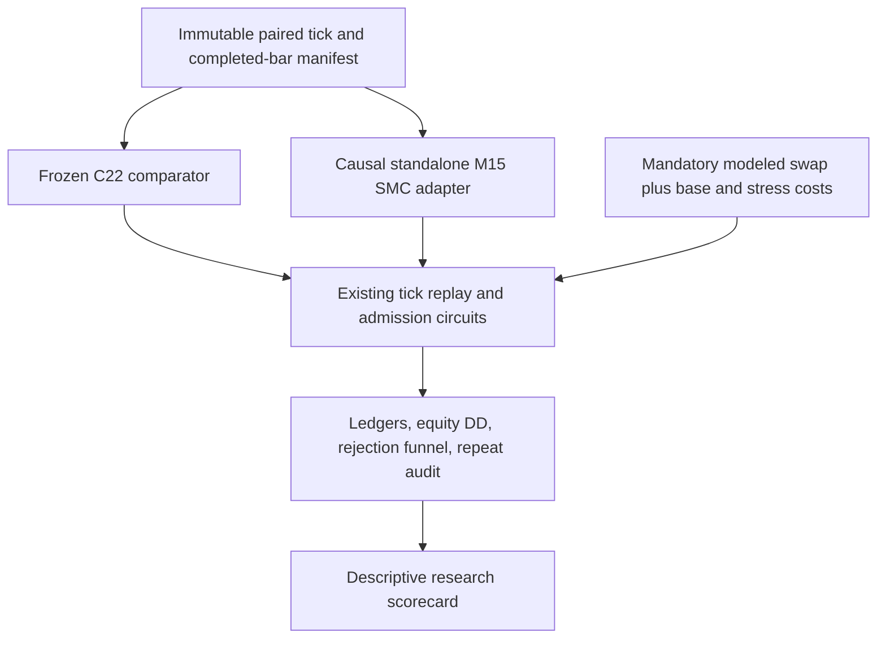

# Shared research infrastructure and SMC boundaries — revised 2026-10-08

Status: proposed staged design. No runtime change or gate relaxation authorized by this review.
Implementation follow-up: Workstream A implemented as the isolated SMC prototype; [evidence](../reviews/2026-10-08-smc-challenger-implementation.md). Optional core extraction and Demo gate changes remain deferred. No sender or migration change.
Original preserved at `/Users/nopparuj/.gemini/antigravity-cli/brain/1ae3cc1d-25d1-4117-a5c5-0608b393cccb/unified_core_and_smc_refactor_plan.md`.
Review: [findings](../reviews/2026-10-08-smc-and-unified-plans-scrutinize.md).
SMC details: [standalone implementation plan](2026-10-08-smc-strategy-implementation-plan.md).

## Intent and smaller alternative

Reduce duplication while allowing SMC research to share proven input, tick replay and cost accounting. First reuse existing infrastructure through a narrow research adapter. Defer `scripts/core/` until two actual consumers demonstrate repeated behavior and equivalence tests justify extraction. Additive duplication alone does not establish a single source of truth.

Original plan mixed infrastructure, strategy changes and live policy changes. Separate these workstreams so a research failure cannot alter Demo admission or rollback behavior.

## Verified current system

| Concern | Current seam and consequence |
| --- | --- |
| C22 detector pins | `scripts/c22h4/strategy.py:40–71` checks9 files plus exact contract. List includes `scripts/strategy.py` and `scripts/pure_b1/broker_data.py`, not only research files. Preserving these hashes does not authorize changing execution behavior elsewhere. |
| C22 day baseline | `scripts/c22h4/runner.py:161` opts into restart equity latch in `scripts/trial30/broker.py:104–119`. Implemented and documented7Oct. Same process keeps latch; another process may latch again for an overnight position. |
| Baseline evidence | `scripts/trial30/broker.py:78–100` reconciles history cashflow and live position volumes before baseline. Do not replace this with a sum of daily profit. |
| Daily controls | `scripts/trial30/runner.py:149–166,288–307` implements separate one-losing-completed-exit and baseline-minus-equity gates. Realized-only loss is different risk policy. |
| Entry timing | `scripts/trial30/runner.py:155–160,239–242` gates both admission and pre-send<=90s. Broker quote freshness<=60s is separate (`broker.py:135–146`). |
| Cost attestation | `scripts/trial30/costs.py:7–42` requires account-bound evidence, units, named source and review age<=24h. Expiration is designed rejection, not proof of a bug. |
| Offline reuse | `c22_frequency_campaign.py:66–86` loads mmap tape and calls canonical tick replay with mandatory `SwapPolicy`; `c22_frequency_data.py:99–155` already writes immutable continuous input. |
| Swap model | `rollover.py:11–60` has signed points, symbol point, triple weekday and boundary calendar; assumptions remain unverified historically. |

## Workstream A: isolated SMC research

Execute companion plan with new modules/config/tests. Existing data/cost/risk/replay paths stay in place. Reuse read-only dependencies and hash their full transitive closure, including SMC helpers, bar providers and adapters. Do not use old `engine.py` as C22 comparator or economic accounting authority.

Canonical flow:

No edge from this pipeline to Demo runner, journal, Telegram or order sender.

## Workstream B: optional infrastructure extraction

Only start after prototype fixtures establish common behavior. Profile before optimizing. Existing mmap does not mean all transforms are zero-copy; report actual RSS, elapsed time and allocations for representative bounded data.

1. Inventory consumers and duplicate logic with exact callers and contracts; select one pure seam at a time.
2. Prefer facade delegating to existing authoritative function over a second implementation. Keep strategy-specific rules supplied explicitly rather than global mutable defaults.
3. Separate research cost assumptions from live attestation. A shared numeric calculation never supplies missing tariff evidence or approves a stale policy. Keep signed swap, calendar and symbol units explicit; `holding_days` alone is insufficient.
4. Define research interface around immutable UTC bars/tapes, versioned broker/cost metadata and validated Rules. A generic SL formula cannot replace live `order_calc_profit`, margin, stop/freeze, Demo identity, exposure and fresh-equity checks.
5. Prove old/new outputs identical across malformed inputs, rounding, gaps, swap boundaries and state/circuit edges. Compare complete baseline results, not only aggregate profit.
6. Do not move/rewrite frozen paths or regenerate pins to make tests pass. Migrating C22 or Trial30 consumers is a separate reviewed change requiring contract/source-pin strategy and rollback evidence.

No `scripts/core/` files are necessary for phase one. If later extraction is justified, document authoritative ownership and version compatibility first; avoid permanently maintaining two tariff/risk engines under a "unified" label.

## Workstream C: Demo gate diagnosis, separately scoped

No `_cycle()` override, expiry fallback or timeout extension in this plan.
If owner later requests a gate investigation, capture timestamped cycle reasons, process starts, journal day state, account fingerprint and attestation provenance with sensitive data redacted. Reproduce observed behavior offline before proposing a fix.

| Gate | Diagnosis and minimal action | Material change requiring separate decision |
| --- | --- | --- |
| Day baseline | Verify current7Oct latch and history consistency; reproduce restart, midnight and floating-position cases. Do not assume `day_start_floating_unknown` is still inevitable in C22. | Realized-only daily loss ignores floating drawdown; persistent restart baseline also changes approved restart semantics. Require policy choice, regression and `CORE_STRATEGY.md`/ops update. |
| Cost expiry | Use existing evidence-backed owner re-attestation workflow; never refresh timestamp without evidence. Distinguish absent, stale, wrong account and unsupported units. | Changing validity duration or evidence workflow requires explicit policy review. Embedded defaults may not admit trades when attestation fails. |
|90s window | Measure bootstrap/poll/quote latency and all rejection paths; improve latency without changing timing contract where feasible. | Delayed-entry policy becomes a separately versioned research scenario with causal signal expiry and quote/risk/parity tests; cannot silently replace frozen window. |

Preserve full lifecycle: account identity -> complete history/exposure -> active-position reconciliation -> admission -> broker risk/geometry/margin -> order_check -> fresh capital/quote/exposure -> persist SENDING -> order_send -> broker-confirmed reconciliation -> transactional notification outbox. Copying `_cycle()` duplicates these seams and risks divergence.

SMC has no Demo execution path under this proposal. Future Demo replacement needs separate readiness review, one sender, owned lifecycle, restart-safe journal, fresh cost evidence, shadow/parity, rollback and owner cutover approval. Real money remains prohibited.

## Verification and completion boundaries

- Phase one: verify source hashes before/after; add causal SMC and adapter tests; run relevant legacy/C22/Trial30/replay/swap suites and full unittest suite at implementation completion. No MT5 smoke test or sender startup needed for this document review.
- Any extraction: differential tests and complete-result parity, with source/config/input/runtime hashes. Performance claims require measured before/after; identical bar counts alone do not prove OHLC/indicator/signal equivalence.
- Any later operational fix: reproduce concrete failure, test all admission and pre-send checks plus UNKNOWN/retry, post-fill risk, partial/complete exit and notification behavior; review docs and rollback before owner-approved deployment.
- Machine outputs go to `runs/<campaign>/`; synthesized markdown goes to `docs/reviews/`. Resume verifies all hashes and bounded catalog; no mutable latest-input or stale checkpoint acceptance.
- Report document review, code implementation, regression, research run, statistical qualification, broker parity, shadow and deployment as distinct statuses.

Verdict: rework original scope; use existing research infrastructure, postpone extraction, and keep Demo policy work separate.
